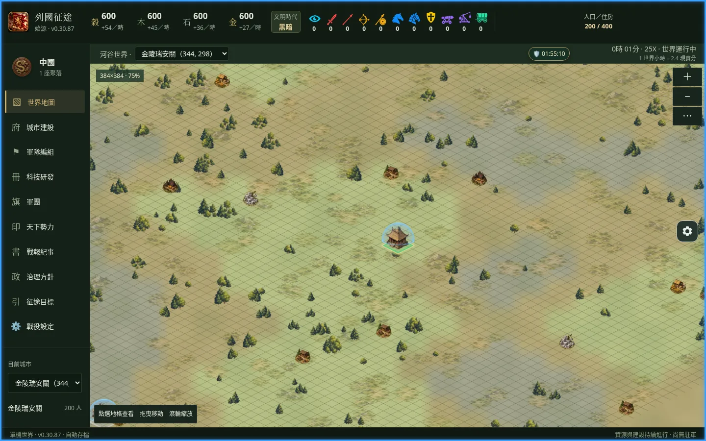

# 列國征途：始源

從一座城邦開始，在持續演化的單機世界中建設城市、發展文明，並與其他領主競逐。這是一款瀏覽器策略遊戲，無需帳號即可免費試玩。

**[開始遊玩 GitHub Pages 公開試玩版](https://cadence-jameds.github.io/lieguo-zhengtu-origin/)**



*實際遊戲畫面：世界地圖，來自先前版本的 Chromium 驗證，介面可能與最新版本略有不同。[來源與其他畫面](docs/validation/global-protection/README.md)*

## 從城邦走向帝國

- 在 384×384 的世界中與 99 位電腦領主共同發展；他們會依遊戲規則自行建設、擴張與行動。
- 建設資源田和城市、管理人口與資源，研究科技並選擇文明發展方向。
- 訓練部隊，派遣行軍與偵察，透過戰報了解戰鬥與損失。
- 使用軍團、帝國與外交介面處理勢力關係；不同情境的完整玩法仍需持續驗證。
- 選擇戰役速度，離開後依設定補算有限的離線時間。這是本機模擬，並非伺服器持續運行。

[城市建設畫面](docs/validation/global-protection/1440-town.png) · [軍隊畫面](docs/validation/global-protection/390-army.png) · [外交畫面](docs/validation/global-protection/390-diplomacy.png)

## 開始與保存

開啟試玩連結，建立戰役、選擇文明及速度後開始。遊戲提供桌面與手機版面；手機尺寸已用桌面 Chromium 模擬，Android 實機與其他裝置仍待驗證。

進度保存在目前瀏覽器的 IndexedDB，沒有帳號同步。不同瀏覽器、裝置和網址來源的存檔分開；清除網站資料可能移除存檔。請先在設定中匯出備份，再進行清理或轉移。舊版存檔不一定相容，請依畫面提示保留原始備份。

## 開發狀態

這是持續開發中的公開試玩，並非正式驗收完成的產品。城市、地圖、軍隊及外交等入口已存在；完整長局、效能、離線恢復與裝置相容性仍需驗證。Android 存檔時間與玩家錯誤提示的修正仍在 [Draft PR #66](https://github.com/cadence-jameds/lieguo-zhengtu-origin/pull/66)，不代表已合併或部署。既有 B5 E1 HOLD、Astra Gate 非 PASS 與實體手機待驗收的歷史證據仍保留；後續裁決以相關正式紀錄為準。

[線上版本與更新紀錄](https://cadence-jameds.github.io/lieguo-zhengtu-origin/release/) · [版本資料](https://cadence-jameds.github.io/lieguo-zhengtu-origin/version.json) · [CI](https://github.com/cadence-jameds/lieguo-zhengtu-origin/actions/workflows/ci.yml) · [Pages 部署](https://github.com/cadence-jameds/lieguo-zhengtu-origin/actions/workflows/deploy-pages.yml)

## AI 協作開發聲明

《列國征途：始源》由一位非專業程式開發者主導設計與開發方向；遊戲構想、世界觀、玩法規則、功能需求、數值與設計決策、試玩回饋、優先順序及最終決策由專案負責人負責。主要程式碼的設計、實作、修改與除錯，以及部分測試和文件，透過 OpenAI Codex 等 AI 工具協作完成。

專案負責人不宣稱所有程式碼均由自己手寫，也不宣稱已逐行完成專業人工審查。專案具有自動化測試、型別檢查及 CI，但實機驗證、長期運行、效能、裝置相容性和功能品質仍有待完成的工作。公開這些資訊，是為了透明呈現 AI 輔助遊戲開發的成果與限制。

## 授權

本專案目前未採用一般性的專案開源授權。公開原始碼不等於授予任意修改、再散布或商業使用的權利；GitHub 平台條款仍可能適用。第三方程式庫和素材依各自條款處理，AI 協作內容的權利也不能僅由此聲明確定。詳見[授權與素材盤點](docs/maintenance/LICENSE_AUDIT.md)。

## 開發與文件

需要 Node.js 22.13 以上：

```bash
git clone https://github.com/cadence-jameds/lieguo-zhengtu-origin.git
cd lieguo-zhengtu-origin
npm ci
npm run dev
```

驗證請執行 `npm run typecheck`、`node scripts/verify-in-isolation.mjs full` 與 `npm run build`。完整回歸必須使用隔離腳本，避免舊測試覆寫歷史證據；smoke 和 r3 均不是完整回歸或正式 Gate。Pages 路徑檢查與發布細節見[版本文件](docs/RELEASE_METADATA.md)。

[正式完整主規格 v97](docs/b6-v97/河谷戰役_vNext_平衡重構討論_v97.md) 依 [AGENTS.md](AGENTS.md) 為現行完整規格；規格不等於已實作。歷史 [v96](docs/b6-v96/河谷戰役_vNext_平衡重構討論_v96.md)、[v95](docs/b6-v95/河谷戰役_vNext_平衡重構討論_v95.md) 保留。另見 [B10 架構](docs/validation/b10-final/ARCHITECTURE.md)、[變更日誌](CHANGELOG.md)、[程式品質審查](docs/maintenance/CODE_QUALITY_AUDIT.md)、[原 README 歷史快照](README_BEFORE_PRESENTATION.md)（其中版本及連結以當時內容為準）。

## English

**Lieguo: Origin** is a single-player browser strategy game about building a city, developing a civilization and sharing a simulated world with 99 computer-controlled lords. Play without an account; saves stay in your browser. The public preview is under development, and device compatibility and long-running play still need validation. [Play](https://cadence-jameds.github.io/lieguo-zhengtu-origin/)
