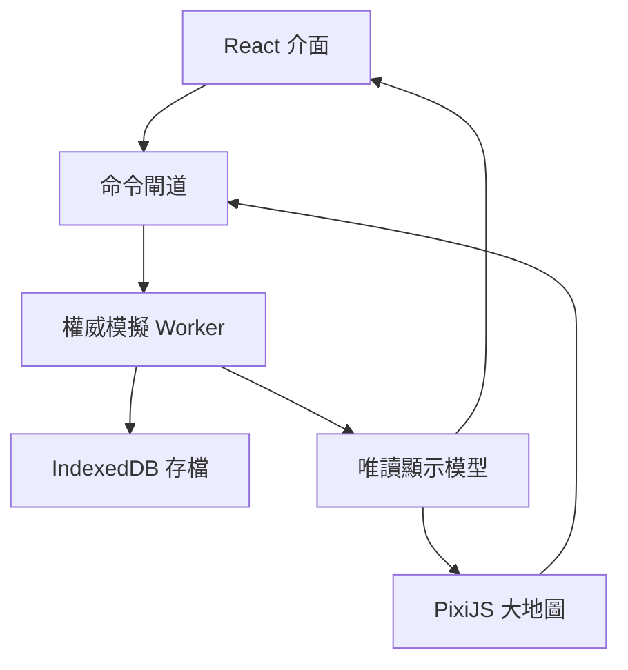

# MVP Technical Production Blueprint v0.1 — 48 小時區域戰役

> 文件狀態：正式 MVP 製作基準；不取代任何正式 Master 或領域模型  
> 產品形態：單機、瀏覽器優先、不可暫停的持續世界策略遊戲  
> 發布目標：GitHub Pages 靜態網站，可安裝為 PWA  
> 本版目的：把已確認的產品選擇轉成可以估工、拆票、實作與驗收的製作藍圖

---

## 0. 文件權限與使用方式

### 0.1 文件優先順序

發生衝突時，依下列順序處理：

1. `MASTER_DESIGN_DOCUMENT_v0.3.md`
2. Economy、City、Technology、Military、World Map、AI、Diplomacy、Player Experience 等正式領域模型
3. 本製作藍圖
4. 程式內的預設值與測試資料

本文件負責定義「第一個真正可玩的版本如何實作」，不能反向改寫 30 日正式戰役的世界規則。

### 0.2 48 小時戰役的定位

48 小時區域戰役是 **MVP 專用垂直切片情境**，不是 Master 中的標準、快速或史詩模式。它可以為驗證遊戲循環而使用專屬地圖尺寸、階段節奏與勝利門檻，但必須遵守下列共同原則：

- 世界持續運行且不能暫停。
- 玩家在線與離線使用同一套模擬規則。
- AI 不作弊，也不知道玩家是否在線。
- 玩家能在地圖上觀察正在發生的變化。
- 戰鬥採戰報與有限改令，不採逐兵 RTS 操作。
- 主動攻擊其他文明會解除新手保護。
- 正式完整版仍只有征服與帝國霸權兩種勝利。
- 帝王時代 → 世界奇觀 → 文明突破工程 → 工業時代的硬順序不得被破壞。

### 0.3 本文件的標記

- **已確認**：來自玩家決定或正式上游文件，實作不得自行更改。
- **MVP 決策**：只約束本垂直切片，不升格為 Master 規則。
- **可調參數**：可依測試結果微調，但改動必須留下版本與驗證記錄。

---

## 1. 第一個版本要證明什麼

### 1.1 一句話產品定義

玩家在一張 Travian 式的大地圖上經營歷史文明，城市、軍隊、資源、外交與 AI 在現實時間中持續運作；玩家每次進入遊戲先理解世界變化，再處理危機、做決策與下令，之後可以繼續觀看，也可以放心離開。

### 1.2 核心玩家循環

> 觀察世界 → 閱讀變化與戰報 → 處理危機 → 做出取捨 → 下達命令 → 在線觀看／有限改令或離線執行

「離線執行」不是遊玩終點，也不是強迫玩家離開。玩家持續在線時，必須能看到：

- 建築與研究倒數前進；
- 商隊與軍隊沿路線移動；
- AI 擴張、集結、交戰與議和；
- 城市易手、道路受阻與國界變化；
- 大型戰役的下一回合倒數及新戰報；
- 資源、人口、糧食與補給狀態逐步改變。

### 1.3 MVP 必須回答的產品問題

第一版不是為了證明「我們能做很多系統」，而是要回答：

1. Travian 式大地圖與《世紀帝國》式歷史文明可讀性放在一起是否好玩？
2. 現實時間建造、行軍與研究是否能形成有意義的回訪節奏，而不是等待遊戲？
3. 玩家關閉瀏覽器後，世界追算是否公平、可理解且不造成存檔焦慮？
4. 戰報能否讓戰鬥有戲劇性，同時避免複雜的 RTS 戰場操作？
5. 五個公平 AI 文明能否讓單機世界看起來真的在自行發展？
6. 一場戰役能否在 48 小時內產生開局、擴張、衝突與清楚終局？

### 1.4 單機而非服務型遊戲

MVP 明確不以登入率、每日任務或長期付費留存為設計目標：

- 不設能量、抽卡、加速付費、賽季通行證或每日登入獎勵。
- 不因錯過登入而把玩家置於無法恢復的純懲罰狀態。
- 不用多餘倒數迫使玩家頻繁打開頁面。
- 可提供開發者時間加速與玩家自訂輔助，但它們不改成多人競爭規則。
- 本地存檔屬於玩家；可手動匯出、備份與搬移。

---

## 2. 已確認的 MVP 決策總表

| 項目 | 決策 | 狀態 |
|---|---|---|
| 平台 | 桌面瀏覽器優先 | 已確認 |
| 最低操作目標 | 1366 × 768、滑鼠與鍵盤 | 已確認 |
| 發布 | GitHub Pages 靜態部署 | 已確認 |
| 執行架構 | 純前端，MVP 無後端、帳號及雲端同步 | 已確認 |
| 世界 | 單機持續世界、不可暫停 | 已確認 |
| 存檔 | IndexedDB 自動存檔、輪替備份、手動匯出／匯入 | 已確認 |
| 地圖呈現 | Travian 式大型區域地圖為主要操作畫面 | 已確認 |
| MVP 地圖 | 固定種子程序生成的 256 × 256 區域 | MVP 決策 |
| 世界資料接口 | 沿用 10,000 × 10,000 邏輯座標及 64 × 64 chunk | 已確認 |
| 節點規模 | 約 80～120 個聚落與重要資源節點 | MVP 決策 |
| 戰役時間 | 48 小時現實時間區域戰役 | 已確認 |
| 時代範圍 | 黑暗、封建、城堡；城堡時代為 MVP 上限 | 已確認 |
| 城市畫面 | 獨立歷史城市全景、固定可點建築槽 | 已確認 |
| 建築操作 | 不自由擺放，不做 RTS 式基地建造 | 已確認 |
| 戰鬥呈現 | Travian 式戰報 | 已確認 |
| 大型戰役 | 地圖顯示狀態、回合倒數與逐回合戰報 | MVP 決策 |
| 在線介入 | 回合間可增援、撤退、改目標，仍受命令延遲 | 已確認 |
| 玩家文明 | 六選一，其餘五個由 AI 控制；同局不重複 | 已確認 |
| 六文明 | 中國、拜占庭、法蘭克、不列顛、日本、蒙古 | 已確認 |
| 美術 | 原創 2D 歷史策略風格，正式但限制動畫量 | 已確認 |
| 內容管線 | 文明、規則與資產路徑分離，可在後續替換 | 已確認 |
| 第三方邊界 | 不使用《世紀帝國》圖像、圖示、音訊、文字、介面或精確數值 | 已確認 |

---

## 3. MVP 範圍

### 3.1 第一個對玩家交付的版本

第一個真正可玩的版本必須是一場可以從選文明開始、以勝利或戰敗結束、關閉瀏覽器後仍可繼續的完整 48 小時戰役。單純地圖瀏覽器、單一城市建造 Demo 或無法結束的 sandbox 不算完成。

玩家應能在同一局中完成：

1. 選擇文明、建立世界種子並進入起始聚落。
2. 發展資源、人口、建築與基礎運輸。
3. 偵察大地圖並辨識五個 AI 文明與中立目標。
4. 進入封建時代，再抵達城堡時代。
5. 建立至少第二座聚落，或占領一個外部聚落。
6. 招募、編組、補給及派遣軍隊。
7. 經歷至少一次小型戰報及一次可分回合的大型戰役或圍城。
8. 使用至少一種外交關係與一次情報行動。
9. 關閉頁面一段時間後，閱讀離線摘要並繼續遊戲。
10. 透過征服或區域帝國霸權結束戰役，或在失敗後讀到清楚原因。

### 3.2 建議的 48 小時體驗節奏

| 戰役時間 | 體驗目標 | 主要玩法 |
|---|---|---|
| 0～8 小時 | 建國與理解周邊 | 起始建設、資源分工、探索、第一支部隊 |
| 約 8 小時 | 封建時代目標 | 第二個發展方向、外交接觸、道路與市場 |
| 8～24 小時 | 區域競爭成形 | 擴張、資源點爭奪、條約、偵察與軍備 |
| 約 24～30 小時 | 城堡時代目標 | 代表兵種、攻城能力、核心城市成形 |
| 30～40 小時 | 主要戰爭 | 聯盟變化、圍城、增援、撤退與占領 |
| 40～48 小時 | 清楚終局 | 反霸權聯合、最後攻勢、勝利倒數或投降 |

期望一局自然形成約 4～8 次主要登入，每次約 10～30 分鐘。這是體驗目標，不是限制；玩家可以一直在線觀看及操作。

### 3.3 MVP 納入內容

| 系統 | MVP 內容 |
|---|---|
| 經濟 | 食物、木材、石材、黃金；鐵與戰馬作為戰略資源；勞動力、庫存與運輸容量 |
| 城市 | 聚落、村莊、城鎮、城市四級；建築槽、資源據點、人口、住房、繁榮與穩定 |
| 建築 | 城市中心、住房、倉庫、市場、兵營、靶場、馬廄、工坊、研究、城防及道路核心集合 |
| 科技 | 黑暗、封建、城堡三時代及其必要研究／採用 |
| 軍事 | 偵察、步兵、槍兵、弓兵、騎兵、攻城器與六種文明代表兵種 |
| 戰爭 | 行軍、補給、偵察、小型即時結算戰報、大型分回合戰役、圍城、撤退與占領 |
| 地圖 | 地形、霧區、聚落、資源、道路、國界、軍隊標記、路線及戰役狀態 |
| AI | 五個公平 AI 文明，具經濟、擴張、外交、防禦、戰爭、投降與區域終局行為 |
| 外交 | 和平、停戰、貿易、通行、同盟、戰爭、投降／附庸的最小閉環 |
| 情報 | 偵察、情報可信度、資訊老化與攻擊預警；不做完整間諜子系統 |
| 離線 | 確定性追算、有限防禦攝政、離線摘要、城市可失守但不因離線刪除文明 |
| 勝利 | 區域征服與區域帝國霸權 |
| 平台 | 可離線啟動的 PWA、本地存檔、匯出／匯入、GitHub Pages 發布 |

### 3.4 明確不納入 MVP

- 帝王、工業、世界戰爭與現代戰爭時代的可玩內容。
- 世界奇觀與文明突破工程的實際施工；只保留穩定 ID、存檔欄位及鎖定介面接口。
- 完整 10,000 × 10,000 世界的全量生成與模擬。
- 數千聚落、數百政治勢力及百萬級軍隊的最終壓力負載。
- 自由建築擺放、逐兵控制、RTS 戰場或動態戰役面板。
- 多人連線、伺服器權威、帳號、排行榜、聊天與雲端同步。
- 手機版、平板版與觸控優化。
- 完整海戰、航空、鐵路、火器工業、革命與現代政治。
- 模組工作坊、公開關卡編輯器及多人分享市場。
- 付費、廣告、分析追蹤、每日任務與服務型營運功能。

未納入不代表從資料結構刪除。所有時代、文明與系統 ID 必須允許後續擴充，不可因 MVP 寫死成三個時代或六個文明的陣列位置。

---

## 4. 六文明與代表兵種

### 4.1 原創內容邊界

六種代表兵種可以採用與《世紀帝國 II》城堡特色兵種相近的 **歷史原型與戰術辨識度**，但不能直接複製該遊戲的名稱組合、圖像、動畫、語音、圖示、數值、科技文字、介面構圖或整套克制參數。

本專案要做到的是：玩家一看就理解「這是中國連弩、東羅馬甲胄騎兵、法蘭克擲斧戰士、英格蘭長弓、武士與蒙古騎射的歷史幻想」，但實際玩法與視覺仍屬本遊戲自己的設計。

### 4.2 MVP 文明身份表

| 穩定 ID | 顯示文明 | MVP 戰略性格 | 城堡時代代表兵種 | 原創戰場角色草案 |
|---|---|---|---|---|
| `civ_zhongguo` | 中國 | 行政、人口與生產網路 | 連弩衛隊 | 短至中程高密度射擊，壓制輕裝集群；怕重甲正面與騎兵突入 |
| `civ_byzantion` | 拜占庭 | 城防、補給與持久戰 | 東羅馬甲胄騎兵 | 高成本重騎兵，擅長衝散步兵與追擊；受槍陣、疲勞與補給限制 |
| `civ_frankia` | 法蘭克 | 農業、騎士與攻勢節奏 | 法蘭克擲斧衛隊 | 中距離重步兵，能處理槍兵與守城步兵；射程短且機動普通 |
| `civ_britannia` | 不列顛 | 情報、遠射與陣地控制 | 不列顛長弓衛隊 | 遠程壓制與先手射擊；近戰脆弱，依賴視野、陣地與護衛 |
| `civ_japan` | 日本 | 紀律、步兵與快速整備 | 武士侍從隊 | 高凝聚近戰精銳，擅長決戰與對抗精銳；昂貴且不宜消耗戰 |
| `civ_mongol` | 蒙古 | 偵察、機動與草原補給 | 蒙古親衛騎射隊 | 移動射擊、襲擾與追擊；不擅長強攻完備城防與長期定點攻城 |

表中的戰略性格及角色是第一輪平衡方向，不是最終加成數字。實作時所有加成、成本、訓練時間、裝備需求與克制值均放在內容資料中，不寫死於畫面或模擬程式。

### 4.3 同局文明規則

- 玩家從六個文明中選一個。
- 其餘五個文明各由一個 AI 國家使用，同局不重複。
- 文明只決定起始偏好、可用內容與戰術傾向，不提供全時代隱藏戰力倍率。
- AI 也必須支付該文明兵種的完整人口、裝備、訓練、維持與補給成本。
- 更換名稱、圖像與平衡資料不得使舊存檔失效；穩定 ID 不隨顯示名稱改變。

---

## 5. 建議技術棧

| 層級 | 技術 | 用途與選擇理由 |
|---|---|---|
| 語言 | TypeScript，strict 模式 | 讓規則資料、命令、事件與存檔遷移可被靜態檢查 |
| 建置 | Vite | 快速開發伺服器、靜態輸出與 GitHub Pages base path 支援 |
| 應用 UI | React | 城市、研究、報告、外交、設定與資訊面板 |
| 大地圖 | PixiJS | GPU 加速 2D 地圖、標記、霧區、路線與縮放 |
| 模擬 | Web Worker | 把追算、AI 與路線計算移出 UI 主執行緒 |
| 本地資料庫 | IndexedDB，建議以 Dexie 封裝 | 儲存 snapshot、事件佇列、備份與多個戰役記錄 |
| 資料驗證 | Zod 或等效 schema 驗證 | 驗證內容 JSON、命令及存檔匯入 |
| 單元／模擬測試 | Vitest | 規則、確定性、遷移與長時間追算測試 |
| 瀏覽器驗收 | Playwright | 從新局、離線恢復到勝利的端對端測試 |
| PWA | Service Worker／Workbox | 第一次完整載入後可離線啟動與使用版本化快取 |
| 自動發布 | GitHub Actions + GitHub Pages | 測試通過後產出靜態網站並部署 |

實際建立專案時鎖定套件版本及 lockfile。本藍圖不把模擬綁死在 React、PixiJS 或 Dexie；`simulation` 與 `content` 套件必須能在無 DOM 的測試環境單獨執行。

---

## 6. 執行架構

### 6.1 權威邊界

- Web Worker 中的模擬世界是唯一權威狀態。
- React 與 PixiJS 只呈現唯讀顯示模型，不直接修改資源、軍隊或倒數。
- 玩家操作先形成命令，通過權限、前置、成本及時間驗證後，才由模擬產生事件。
- UI 的動畫時間不是世界時間；掉幀或切到背景不會改變結算。
- 所有 AI 使用與玩家相同的命令與規則接口，不能直接寫入結果。

### 6.2 命令與事件

玩家或 AI 提交的命令至少包含：

- `commandId`
- `campaignId`
- `issuerId`
- `issuedWorldTime`
- `commandType`
- `targetIds`
- `payload`
- `expectedRevision`

排程事件至少包含：

- `eventId`
- `dueWorldTime`
- `priority`
- `sequenceId`
- `eventType`
- `actorId`
- `payload`
- `rngStreamId`

同一時間的事件固定依 `dueWorldTime → priority → sequenceId` 排序。結果不依裝置速度、畫面幀率或物件遍歷順序決定。

### 6.3 套件與目錄責任

| 路徑 | 責任 |
|---|---|
| `src/simulation/` | 世界時間、命令驗證、事件、經濟、城市、戰鬥、AI 與勝利 |
| `src/content/` | 文明、兵種、建築、科技、地形及情境資料與 schema |
| `src/worker/` | Worker 訊息協定、追算批次與唯讀模型輸出 |
| `src/persistence/` | IndexedDB、備份、匯入匯出、校驗與版本遷移 |
| `src/map/` | PixiJS renderer、chunk、圖層、霧區、選取與路線預覽 |
| `src/ui/` | React 頁面、面板、報告、通知、無障礙替代資訊 |
| `src/assets/` | 可替換圖像、atlas、音訊、字型與資產 manifest |
| `src/scenarios/` | 48 小時 MVP 情境、出生規則、節奏與勝利縮放 |
| `src/devtools/` | 時間加速、世界檢視、事件追蹤及平衡工具；正式版預設關閉 |
| `tests/` | 單元、確定性、存檔遷移、地圖公平及端對端測試 |

---

## 7. 世界時間與確定性

### 7.1 持續世界在純前端的正確含義

瀏覽器關閉時不可能真的在玩家裝置上持續執行程式。MVP 的「世界永遠運行」採用可觀察等價模型：

- 儲存最後一次已提交的世界時間與必要狀態。
- 玩家重開遊戲時，計算現實經過時間。
- 使用與在線時完全相同的事件處理器，把世界確定性推進到現在。
- 玩家先看到追算後的世界與摘要，再繼續下令。

因此玩家關閉瀏覽器不會凍結戰役；技術上則不需要常駐伺服器。

### 7.2 時鐘來源

每個戰役保存：

- `worldTimeMs`：已完成結算的世界時間。
- `lastCommittedWallClockMs`：最後成功寫入時的裝置 UTC 時間。
- `sessionMonotonicMs`：本次開啟期間使用的單調時間基準。
- `timelineRevision`：每次成功提交後遞增。
- `campaignSeed` 與各子系統 `rngState`。

開啟期間以單調時間推進，避免使用者調整系統時間造成倒退。重新開啟後才使用 UTC 差值計算離線時間。

### 7.3 事件驅動而非逐秒暴力模擬

- 建造完成、軍隊抵達、戰役回合、條約到期、AI 評估及警報均為精確排程事件。
- 資源生產、人口消耗與恢復等連續量，以「速率 × 經過時間」積分到下一個狀態邊界。
- 倉庫滿、糧食歸零、道路中斷等會改變速率的時間點，必須生成邊界事件。
- 偏遠且無事件的聚落可按較大時間塊聚合，但總量、上限與事件順序必須等價。
- 模擬使用整數或明確定義的定點數；修正倍率以 basis points 等整數單位儲存，避免跨瀏覽器浮點漂移。

### 7.4 隨機規則

- 模擬程式禁止直接使用 `Math.random()`。
- 採一個固定規格、可保存狀態的 32 位元偽隨機演算法。
- 地圖、AI、戰鬥與事件使用分離的 RNG stream，避免新增一段環境音效就改變戰鬥結果。
- 相同 seed、內容版本、初始狀態與命令序列必須產生相同世界 hash。

### 7.5 線上、背景與關閉狀態

| 狀態 | 模擬方式 | 玩家看見的結果 |
|---|---|---|
| 前景在線 | Worker 週期性推進至當前時間，地圖以動畫插值顯示 | 世界持續更新，可立即下令 |
| 背景分頁 | 瀏覽器可能節流；恢復可見時依實際差值補算 | 不因分頁節流而少算或多算 |
| 裝置休眠 | 恢復時執行同一追算流程 | 睡眠期間仍算入世界時間 |
| 瀏覽器關閉 | 不執行 CPU；下次開啟時確定性追算 | 與持續在線的規則結果等價 |
| 離線網路 | 已安裝快取與本地資料足夠時照常遊玩 | 無需伺服器即可讀寫存檔 |

---

## 8. 離線追算

### 8.1 開啟戰役流程

1. 取得該戰役的單一寫入鎖。
2. 讀取最新有效 snapshot、事件佇列、RNG 狀態及內容版本。
3. 驗證 checksum；失敗時依序嘗試輪替備份。
4. 在追算前再建立一份不可覆蓋的恢復點。
5. 計算自 `lastCommittedWallClockMs` 起的非負經過時間。
6. 依時間與穩定排序處理排程事件；AI 只在自己的預定評估點決策。
7. 每批處理後檢查取消、記憶體與完整性，必要時把追算進度回報 UI。
8. 到達當前時間後建立新 snapshot，原子提交狀態與新事件佇列。
9. 生成玩家可讀的離線摘要，再開放新命令。

### 8.2 追算摘要

離線摘要不應傾倒完整事件 log。它先顯示最重要結果，再讓玩家展開：

1. 核心城市危機、失守、圍城與攝政行動。
2. 戰爭、戰報、軍隊抵達、撤退及補給中斷。
3. 外交提案、宣戰、投降、條約與世界勢力變化。
4. 時代、科技、城市升級與重要工程完成。
5. 資源淨變化、倉庫滿溢、缺糧與生產停工。
6. 一般建設、人口及低優先事件的合併摘要。

每項摘要都可連到相關城市、軍隊、報告或地圖位置。

### 8.3 長時間與大量事件

- 不設「離線超過 8／24 小時就停止生產」的人為上限。
- 真正限制來自倉庫容量、糧食、人口、維護、命令條件與敵人行動。
- 追算超過 1 秒時顯示進度與目前處理的世界時間。
- 追算分批執行並定期讓出訊息迴圈，避免頁面看似當機。
- 追算中止不破壞原 snapshot；只有完整批次驗證後才切換目前版本。

### 8.4 裝置時間異常

本作是單機遊戲，MVP 不建立侵入性的反作弊系統：

- 同一開啟期間使用單調時間，系統時鐘變動不影響模擬。
- 重新開啟若時鐘倒退，離線差值視為 0、保存恢復點並顯示提醒，不倒扣進度。
- 異常大的正向跳躍仍可追算，但先備份並顯示追算範圍；不得因此損壞存檔。
- 時鐘異常記在診斷資料中，不羞辱或懲罰玩家。

若未來加入多人或雲端競爭，必須另建伺服器權威時間；不能把該需求偷塞回目前單機架構。

### 8.5 多分頁衝突

- 同一戰役同時只允許一個寫入者。
- 優先使用 Web Locks API，並以 BroadcastChannel 做分頁間狀態通知。
- 第二個分頁預設唯讀，可要求接管；接管前要求原分頁完成 flush 或安全失效。
- 不允許兩個 Worker 各自追算後以最後寫入者覆蓋另一份世界。

---

## 9. 存檔、備份與版本遷移

### 9.1 IndexedDB 邏輯資料表

| Store | 內容 |
|---|---|
| `campaigns` | 戰役名稱、seed、文明、建立時間、內容版本及目前狀態 |
| `snapshots` | 權威世界 snapshot、世界時間、revision、checksum |
| `eventQueue` | 尚未結算的排程事件 |
| `commandLog` | 自最近基準 snapshot 後的命令與結果摘要 |
| `backups` | 輪替恢復點與建立原因 |
| `settings` | 顯示、聲音、通知、攝政政策與無障礙設定 |
| `contentMeta` | schema、內容套件及遷移版本 |

### 9.2 寫入原則

- 玩家提交重要命令後快速存檔。
- 頁面轉入背景、PWA 安裝更新、追算前後與戰役結束時強制存檔。
- 平時每 5 分鐘或每 100 個重大事件建立 snapshot，以先到者為準。
- 寫入新 snapshot、事件佇列與 meta 後，才原子切換 `currentRevision`。
- 至少保留 5 份自動恢復點；手動匯出不受輪替刪除。
- 戰役資料與 HTTP／Service Worker 快取完全分離，更新網站不能清除存檔。

### 9.3 匯出格式

建議使用自訂副檔名 `.realm-save`，內容為可壓縮的版本化資料包，至少包括：

- `formatId`
- `schemaVersion`
- `contentVersion`
- `gameBuild`
- `campaignId`
- `createdAt`
- `worldTimeMs`
- `campaignSeed`
- `snapshot`
- `pendingEvents`
- `rngStates`
- `checksum`

匯入時先在隔離記憶體中驗證格式、大小、schema、checksum、ID 參照及遷移結果。成功後建立新戰役或由玩家明確選擇覆蓋，不直接修改目前存檔。

### 9.4 版本遷移

- 每個 schema 版本只能透過明確的 `vN → vN+1` 遷移函式前進。
- 遷移前自動保存原始檔，遷移後重新驗證世界不變量。
- 顯示名稱與資產可以換；穩定內容 ID 不可任意換。
- 若內容已移除，提供 deprecated alias 或安全替代，不能讓整局無法載入。
- 新版無法安全理解舊存檔時，停止載入並保留原檔，不做猜測性修補。

### 9.5 容量與持久性提示

- 啟動後可向瀏覽器請求 persistent storage，但不能假設一定獲准。
- 設定頁顯示估計存檔用量、最新備份與最新匯出時間。
- 完成教學及每個主要里程碑後，友善提醒玩家匯出備份；不反覆打擾。
- 清除瀏覽器網站資料會刪除本地存檔，因此匯出功能在 MVP 不得延後。

---

## 10. 地圖生成與呈現

### 10.1 邏輯尺寸

- 正式世界資料模型保留 `x: 0..9999`、`y: 0..9999` 的 10,000 × 10,000 邏輯座標。
- chunk 固定為 64 × 64；MVP 的 256 × 256 區域正好是 4 × 4 chunks。
- 不建立一個常駐記憶體中的一億格二維陣列。
- 基礎地形由 seed 與 chunk 座標重建；只有被發現、改造或發生事件的資料持久化。
- 聚落、軍隊、道路、資源點與國界以稀疏實體及空間索引保存。

### 10.2 固定種子生成流程

1. 以 campaign seed 產生高程、水分、溫度與地貌。
2. 建立河流、水域、山脈、森林及主要通行走廊。
3. 放置農業、木材、石材、鐵、戰馬與黃金資源區。
4. 放置中立聚落與六個文明的首都候選區。
5. 建立既有小徑、區域道路與可爭奪的交通咽喉。
6. 驗證每個出生點的最低生存資源、擴張空間與對外路線。
7. 驗證六個文明間的距離與優勢沒有超出容許範圍。
8. 若失敗，以確定性的子 seed 重試；保存生成報告供除錯。

### 10.3 出生公平驗收

每個文明起點必須具備：

- 可在合理開局時間取得食物、木材、石材與黃金；
- 至少一條不必穿越敵國即可到達的擴張走廊；
- 至少兩個不同方向的中期戰略選擇；
- 不會被山脈、水域或單一狹口完全鎖死；
- 距最近文明及中立目標的時間差在設定容許範圍內；
- 有機會取得鐵或戰馬，但不保證兩者都在首都旁邊。

### 10.4 地圖圖層

由下到上分為：

1. 地形與水域。
2. 河流、道路、橋樑及交通狀態。
3. 政治控制與邊界。
4. 聚落、資源點、要塞及地標。
5. 軍隊、商隊、視野來源與大型戰役標記。
6. 玩家選取、命令路線、補給範圍、威脅與情報覆蓋。
7. HTML UI 的工具提示、面板、警報及報告入口。

PixiJS 只渲染可見 chunks 與一圈預載邊界。縮遠時聚合圖示與軍隊，不逐格畫出所有細節；縮近時才顯示道路、地形與單一節點資訊。

### 10.5 地圖不是裝飾背景

- 軍隊標記沿實際路線移動，不在倒數結束時瞬間傳送。
- 玩家看到的是情報允許的狀態，不是全知地圖。
- 地圖上的舊情報要顯示時間與可信度。
- 大型戰役標記顯示目前階段、下一回合與可下達的有限命令。
- 小型戰鬥只留下戰報與短期痕跡，不打開獨立戰場。

---

## 11. 城市全景與可替換美術

### 11.1 城市畫面

- 從大地圖選擇城市後，進入獨立的 2D 歷史城市全景。
- 城市槽使用預先定義的可點區域，不允許任意拖放建築。
- 城市中心、一般建築槽、資源據點與基礎設施保持不同概念。
- 建築升級以外觀層、施工覆蓋及狀態圖示呈現，不要求每級製作完全不同的大圖。
- 可使用少量旗幟、煙、水、工地與人流動畫，避免為動畫拖垮 MVP。

### 11.2 資產資料結構

每個視覺資產由 manifest 以穩定 key 取得，例如：

- `civ_zhongguo.city.castle.background`
- `building_market.level_2.sprite`
- `unit_longbow_guard.map_marker`
- `report_siege_victory.illustration`

規則資料只引用 asset key，不引用檔名或硬編路徑。文明特有資產缺少時依序回退到時代通用、文化圈通用及全域 placeholder；不因換圖而修改模擬程式或存檔。

### 11.3 建議格式

- 大型城市背景：WebP，必要時提供 PNG 備援。
- 圖示及簡單介面向量：SVG。
- Sprite／atlas：PNG 或 WebP atlas 加 manifest。
- 所有來源保留授權與作者記錄。
- 正式資產不得由《世紀帝國》遊戲檔、截圖、音訊或其衍生素材製作。

---

## 12. MVP 系統裁切

### 12.1 經濟與城市

- 核心資源沿用食物、木材、石材、黃金。
- 城堡時代軍備再加入鐵與戰馬；硝石、煤、石油、電力及鋼材先只保留 schema。
- 資源存在於聚落庫存，跨城調度必須經過道路、容量與時間。
- MVP 支援聚落、村莊、城鎮與城市；大城市、世界級都會留到完整版。
- 起始約 300 人，城市升級仍檢查人口、住房、糧食、城市中心與穩定，不只檢查倒數。
- 玩家直接管理少數核心城市，其餘以簡化政策運作；即使區域地圖不大，也先驗證自動化接口。

### 12.2 研究與時代

- 可玩時代只有黑暗、封建、城堡。
- 研究完成與科技採用仍是兩件事；高級軍備要有設施、人員與裝備能力。
- 進入城堡時代後開啟文明代表兵種、較完整城防與攻城能力。
- 帝王時代按鈕可以顯示為「不在本區域戰役中」，不能以假成本進入。
- `era_imperial`、`project_world_wonder`、`project_civilization_breakthrough` 等穩定 ID 仍預留於內容與存檔版本。

### 12.3 軍隊與戰報

軍隊以編制聚合，不保存每名士兵的獨立 AI。小型戰鬥在接觸事件抵達時結算並生成一份完整戰報；大型戰役與圍城分成有間隔的回合：

- 地圖顯示戰役正在進行及下一回合時間。
- 每個回合生成兵力、士氣、裝備、補給、地形與主要原因摘要。
- 回合間可下令增援、有限撤退或改變後續目標。
- 新命令要經情報、通信、指揮與行軍延遲，不立即改寫已結算回合。
- 不提供逐兵選取、技能施放、戰場鏡頭或動態戰役面板。

戰報必須回答：誰參戰、為何發生、資訊可信度、戰前／戰後兵力、傷亡、裝備損失、補給、士氣、地形、關鍵修正、戰果、戰利品、下一狀態及可採取行動。

### 12.4 AI

五個 AI 文明：

- 使用相同資源、建築、研究、軍隊、情報、外交與行軍規則。
- 不讀取玩家未揭露軍力、庫存、命令或在線狀態。
- 以低頻戰略／外交評估、事件驅動危機反應及較高頻戰區評估組成。
- 要有可讀的長期意圖，不每次評估都換目標。
- 可以議和、撤退、投降與成為附庸，不戰到最後一人。
- 在離線追算中只於原定評估時間決策，不能因一次補算而獲得更多思考回合。

MVP 不追求完整版的數百政治勢力，但所有 AI 決策要記錄內部原因，方便平衡與查錯。

### 12.5 玩家有限攝政

攝政可以依玩家事先設定及實際情報：

- 調動已授權預備隊；
- 防守、撤退、補給、修復與護送；
- 執行明確的最低守軍與撤退門檻；
- 在預算上限內補充必要軍需。

攝政不得：

- 宣戰、掠奪或占領新領土；
- 主動擴張、建立新殖民地或重寫玩家發展方向；
- 簽永久條約、投降整個文明或啟動勝利倒數；
- 啟動世界奇觀、文明突破或其他不可逆國策。

### 12.6 外交與情報

- 外交以明確狀態與提案形成最小閉環，不先做自由文字談判。
- AI 提案顯示期限、理由、代價及預期結果。
- 情報有來源、觀測時間、可信度及估計範圍。
- 新手保護期內，AI 不能以偵察、代理人或封鎖繞過禁止主動攻擊的規則。
- 玩家對其他文明發出第一個敵對政治命令後，保護立即且永久解除；教學與強盜目標除外。

---

## 13. 區域勝利與 48 小時縮放

### 13.1 區域征服

區域征服的完成條件為：地圖上已無仍具獨立戰爭能力、拒絕停戰且能阻止玩家控制區域的主要敵對文明。已投降、接受附庸或失去獨立戰爭能力的文明可以不再阻擋勝利。

征服不要求占領每個中立村莊、清除每名強盜或把地圖塗成單一顏色。

### 13.2 區域帝國霸權正式規則

下列數值已確認為 48 小時 MVP 特別情境規則，不修改 Master 的正式 1,500 聚落與 72 小時規則：

| 條件 | 48 小時區域正式值 |
|---|---|
| 有效直接控制聚落 | 30 座 |
| 綜合地位 | 人口、軍事與經濟三項均居第一 |
| 控制品質 | 聚落必須有補給、行政及最低整合，空殼占領不計 |
| 霸權危機 | 條件成立後維持 4 小時 48 分鐘 |
| 反制 | 其他文明可結盟、封鎖、援助敵人或直接宣戰 |

若玩家在倒數中失去任一必要條件，霸權倒數立即中止並歸零；重新取得全部條件後，必須重新完整維持 4 小時 48 分鐘。這符合 Master「持續維持全部條件」的原則，不保留部分進度。

### 13.3 保護與警報正式值

Master 的標準模式為 72 小時新手保護及核心城市至少 6 小時緊急警報。48 小時區域戰役不能直接照搬，否則大部分戰役都無法發生戰爭。

48 小時 MVP 正式採用：

- 新手保護：20 小時；玩家先發出敵對政治命令仍立即解除。
- 核心城市最低緊急警報：100 分鐘；良好情報可更早發現。
- AI 在保護解除後仍要經決策、集結與真實行軍，不能瞬間出現在城下。

上述數值屬 MVP 可調參數。若完整自動模擬及人工遊玩顯示體驗明顯失衡，必須以新版本記錄修改理由與測試結果；不能暗中改值，也不能用單純比例縮放取代體驗驗證。

---

## 14. 介面與導航

### 14.1 常駐框架

- 頂部：核心資源、人口、世界時間、時代、重要倒數與警報。
- 中央：預設為大地圖；切換城市時顯示全景。
- 左側或可收合區：目前選取物、快捷城市／軍隊清單。
- 右側：情境面板、命令、排程、情報與原因說明。
- 底部或主導航：地圖、城市、軍隊、研究、外交、戰報、世界消息及設定。

### 14.2 必備畫面

1. 新戰役：文明、難度、seed 與規則摘要。
2. 大地圖：搜尋、縮放、定位、情報、路線與命令。
3. 城市全景：建築槽、資源、人力、佇列、政策與駐軍。
4. 研究：時代條件、研究進度、採用條件與鎖定原因。
5. 軍隊與命令：編組、目標、路線、姿態、撤退與補給。
6. 戰報：摘要、比較、原因、損失及下一步。
7. 外交：關係、提案、條約、威脅及已知意圖。
8. 離線摘要：重大變化優先，能跳到來源。
9. 設定與存檔：攝政、通知、匯出、匯入、備份及版本。
10. 勝利／戰敗：條件如何成立、世界狀態及繼續觀看選項。

### 14.3 可讀性要求

- 不能只用顏色表達敵我、資源短缺或命令狀態。
- 所有倒數同時顯示完成的世界日期／時間。
- 所有鎖定按鈕都要說明缺少的條件。
- 戰報及離線摘要能以鍵盤瀏覽，地圖資訊另有清單表示。
- 報告使用本遊戲自己的排版與圖像語言，不模仿 Travian 或《世紀帝國》的具體介面。

---

## 15. PWA 與 GitHub Pages 發布

### 15.1 靜態部署條件

- 所有核心遊戲邏輯、內容與資產編譯為靜態檔案。
- MVP 不需要 API、資料庫伺服器、登入服務或秘密金鑰。
- 使用 GitHub Actions 執行 lint、typecheck、unit tests、build 及 smoke test；通過後才部署 Pages。
- 建置設定必須支援專案子路徑，例如 `/repository-name/`。
- 建議使用 hash routing，避免 GitHub Pages 直接開啟內頁時出現 404。

### 15.2 PWA 更新

- 第一次完整載入後，應能在無網路時開啟遊戲與讀取本地戰役。
- Service Worker 快取 app shell 及版本化資產，不接管 IndexedDB 存檔。
- 發現新版時先提示，等玩家同意重新載入；套用前完成存檔。
- 若新內容需要遷移，先備份、遷移、驗證，再啟用新版本。
- 資產更新失敗時保留上一個可啟動版本，不讓半套快取破壞遊戲。

### 15.3 此架構的已知限制

- 存檔只存在目前瀏覽器與裝置，除非玩家匯出搬移。
- GitHub Pages 不能提供權威持續運行的伺服器世界。
- 瀏覽器儲存空間可能被使用者清除，匯出備份不可省略。
- 系統時間可被單機玩家調整；MVP 選擇保護存檔與透明提示，而非服務型反作弊。
- 若日後要跨裝置同步、帳號或多人，必須另設後端，不能只靠替換幾個存檔函式完成。

---

## 16. 效能預算

測試基準以中階 Windows 桌機或筆電、1366 × 768 以上解析度及主流 Chromium／Firefox 桌面瀏覽器為主。

| 項目 | MVP 目標 |
|---|---|
| 大地圖平移／縮放 | 正常情境維持 60 FPS 目標；大量標記時不得長時間低於 30 FPS |
| UI 互動 | 一般操作主執行緒長任務低於 50 ms |
| 初次可操作 | 合理寬頻下關鍵 shell 與初始內容在 3 秒級開始回應 |
| 關鍵初始下載 | 建議不超過 15 MB；城市大圖與非目前文明資產延遲載入 |
| 記憶體 | 48 小時 MVP 地圖與五 AI 正常遊玩目標低於 500 MB |
| 24 小時追算 | 目標 5 秒內完成 |
| 48 小時追算 | 目標 10 秒內完成；超過 1 秒顯示進度 |
| 自動存檔 | 一般提交不造成超過 100 ms 的可感知卡頓 |
| 確定性 | 相同 seed 與命令流的在線／離線最終世界 hash 完全相同 |

效能問題不能靠刪除真實成本、跳過 AI 行動或改寫戰果解決；應使用事件聚合、可見 chunk、空間索引、Worker 與唯讀模型差量更新。

---

## 17. 測試與驗收

### 17.1 必要自動測試

- 每項玩家命令的前置、成本、排程與拒絕原因。
- 資源守恆、人口守恆、裝備守恆及道路容量。
- 城市升級、時代門檻與城堡上限。
- 同一戰鬥 seed 與輸入得到同一戰報。
- 在線連續運行與一次離線追算得到同一世界 hash。
- 背景分頁節流與恢復不重複結算。
- snapshot 中途寫入失敗後可從前一版本恢復。
- 每一個支援的 schema 遷移路徑。
- 匯入錯誤、惡意或過大資料不破壞現有存檔。
- 多分頁只能有一個寫入者。
- AI 看不到未揭露情報，也不依玩家在線狀態改變決策。
- 地圖 seed 可重現，六個出生點通過公平門檻。
- GitHub Pages 子路徑、重新整理及離線啟動。

### 17.2 情境測試

至少準備下列固定 seed 的 headless 情境：

1. 和平發展至城堡時代。
2. 玩家主動解除保護並遭反擊。
3. 玩家離線時首都遭圍城，攝政調兵與撤退。
4. 大型戰役經三回合、雙方增援後結束。
5. 道路被切斷導致軍隊缺糧及撤退。
6. AI 取得區域霸權條件並觸發反霸權反應。
7. 玩家文明失去首都但仍保有復國可能。
8. 48 小時內以征服結束。
9. 48 小時內以帝國霸權結束。
10. 從舊版存檔升級後完成戰役。

### 17.3 第一個真正可玩版本的通過條件

- 玩家不開除錯工具即可完成一場 48 小時戰役。
- 六個文明皆可選，且其餘五文明能完整由 AI 操作。
- 黑暗 → 封建 → 城堡的三時代流程均能完成。
- 大地圖、城市、研究、軍隊、外交、戰報與離線摘要形成完整導航。
- 瀏覽器關閉至少 8 小時後，可正確追算、顯示摘要並繼續遊戲。
- 存檔可匯出到檔案，再於乾淨瀏覽器資料中匯入繼續。
- 至少一種征服與一種帝國霸權路線經人工測試完成。
- 沒有會遺失整局、重複資源、複製軍隊或跳過時代的已知高嚴重度錯誤。
- 在目標硬體上達到效能預算，且背景切換不造成時間錯亂。
- 所有正式圖像、字型及音訊均有可追蹤的原創或授權來源。

---

## 18. 開發里程碑與驗收閘門

不先承諾日曆週數；完成速度取決於開發人數、美術來源與每週投入。每一階段以可測試結果過關，不以「程式寫了一半」計完成。

### M0 — 專案骨架與自動部署

- 建立 TypeScript、React、PixiJS、Worker、測試及內容 schema。
- GitHub Actions 能產生 GitHub Pages 預覽。
- 子路徑、版本資訊、錯誤頁及 PWA shell 正常。

**閘門：** 空白世界能在發布網址與本機離線重新開啟。

### M1 — 無畫面的確定性世界

- 世界時鐘、命令、事件佇列、RNG、snapshot 與 IndexedDB 完成。
- 支援背景恢復、關閉追算、備份及匯出／匯入。
- 建立可快速推進 48 小時的 headless runner。

**閘門：** 在線與離線命令流的最終 hash 完全相同，故障寫入可恢復。

### M2 — 大地圖與城市經濟循環

- 程序生成 256 × 256 地圖與六文明起點。
- 完成地圖選取、城市全景、四項核心資源、人口、建築佇列及道路。
- 完成黑暗與封建時代的發展流程。

**閘門：** 玩家能從新局建成第二個聚落，離開後回來仍正確發展。

### M3 — 行軍、研究與第一份戰報

- 軍隊編組、路線、行軍、偵察、補給與小型戰鬥完成。
- 加入城堡時代、通用兵種及至少一個代表兵種的端到端內容。
- 戰報能解釋結果及下一步。

**閘門：** 在開發時間加速下，可完整完成「偵察 → 出兵 → 接戰 → 戰報 → 回城」。

### M4 — 五 AI、大型戰役與外交

- 五個 AI 可發展、擴張、外交、宣戰、撤退、投降與追求勝利。
- 完成大型分回合戰役、圍城、占領、有限改令、預警及攝政。
- 完成區域征服與區域帝國霸權流程。

**閘門：** 固定 seed 的 48 小時自動戰役能穩定產生終局，無作弊或事件爆炸。

### M5 — 六文明內容與完整 UX

- 六文明、六代表兵種及文明視覺辨識全部接入資料管線。
- 完成世界消息、離線摘要、設定、存檔管理與新手引導。
- 補齊原創正式版城市背景、地圖圖示與戰報插圖的最低集合。

**閘門：** 新玩家能在沒有開發者口頭說明的情況下玩完主要流程。

### M6 — MVP Release Candidate

- 執行平衡、效能、瀏覽器、無障礙、遷移及長時間穩定測試。
- 清除高嚴重度錯誤，確認授權清單與發布包。
- 以一般速度人工完成至少兩場 48 小時戰役。

**閘門：** 通過第 17.3 節所有條件後，才稱為第一個真正可玩的公開版本。

---

## 19. 主要風險與控制方式

| 風險 | 可能結果 | 控制方式 |
|---|---|---|
| 系統範圍過大 | 很久都沒有可玩的版本 | 嚴格鎖在三時代、區域圖與最小外交／情報閉環 |
| 追算事件爆炸 | 回來後頁面長時間卡住 | 事件驅動、連續量積分、分層 AI、批次處理及效能測試 |
| UI 與模擬互相污染 | 掉幀改變結果、難以測試 | Worker 權威、命令接口、唯讀顯示模型 |
| 本地存檔消失 | 玩家失去整場戰役 | 輪替備份、匯出／匯入、persistent storage 提示 |
| 背景分頁重算 | 資源或戰鬥重複結算 | revision、原子提交、單一寫入鎖與確定性測試 |
| AI 看似作弊 | 單機世界失去可信度 | 信念資料分離、命令共用、原因 log 及情報測試 |
| 六文明美術拖慢開發 | 系統完成但內容無法交付 | 通用骨架、manifest、fallback 資產及分批替換 |
| 過度接近參考作品 | 法律與品牌風險 | 只取高層玩法／歷史題材，全部資產、數值、文字與介面原創 |
| 48 小時太快或太慢 | 開局冗長或終局未形成 | headless 多局模擬、時間加速、人工遊玩與版本化參數調整 |
| GitHub Pages 限制擴張 | 後來需求需要帳號或同步 | MVP 明確無後端；真正需要時另立架構版本，不偽裝成小改動 |

---

## 20. 已定案項目與後續製作選擇

48 小時戰役的四項核心平衡規則已定案：

1. 新手保護 20 小時。
2. 核心城市最低緊急警報 100 分鐘。
3. 區域帝國霸權需要 30 個有效直接控制聚落，並維持全部條件 4 小時 48 分鐘。
4. 霸權條件一旦中斷，倒數歸零；重新達標後重新計時。

其餘架構已足以開始建立 repo 與 M0／M1。以下只影響製作成本或發布方式，可在進入相關里程碑前再決定，不阻擋程式骨架開工：

1. **程式碼倉庫可見性：** 公開原始碼或私人倉庫；發布網站本身可另行公開。
2. **聲音範圍：** MVP 只有 UI／環境提示，或再加入文明語音及戰報音景。
3. **首輪美術規格：** 城市背景尺寸、地圖縮放級別及代表兵種所需姿態數量。

---

## 21. 藍圖結論

MVP 的合理形態不是把 30 日完整版硬做一半，而是建立一場自成完整弧線的 48 小時區域戰役：六個不重複文明在 256 × 256 的 Travian 式大地圖上發展至城堡時代，透過真實時間建設、行軍、外交、戰報、有限改令與離線追算，走向征服或區域霸權。

技術上以 TypeScript、React、PixiJS、Web Worker、IndexedDB 與 PWA 組成純前端架構，足以發布在 GitHub Pages；模擬、內容與美術彼此分離，既能先做出好玩的第一版，也保留日後擴張到 10,000 × 10,000 世界、帝王時代、世界奇觀與文明突破的正確接口。
