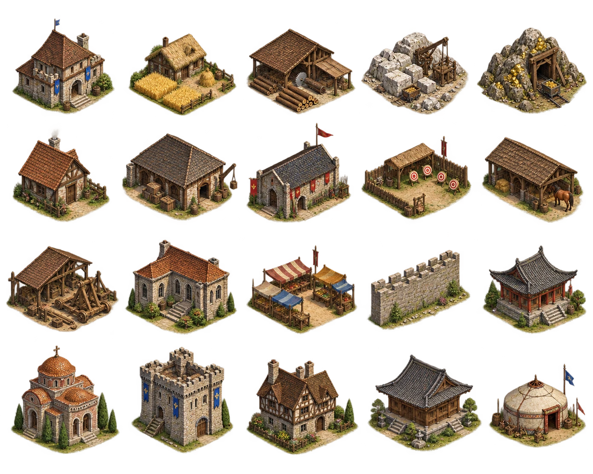
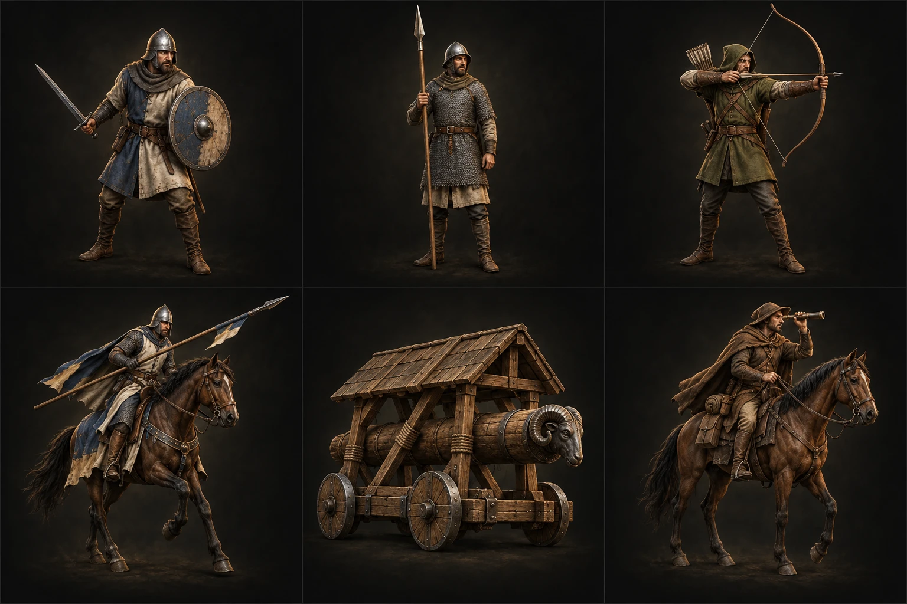
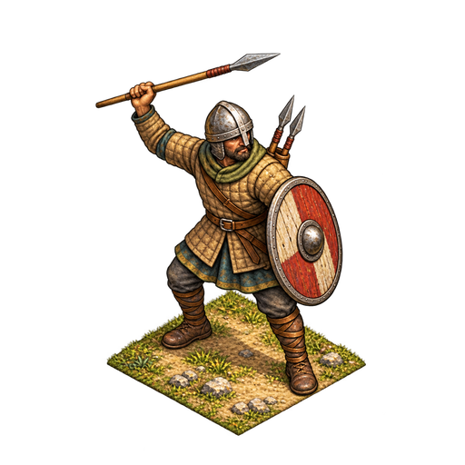
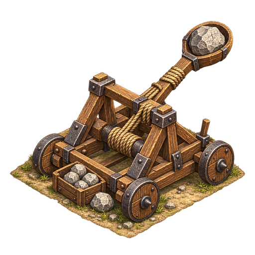
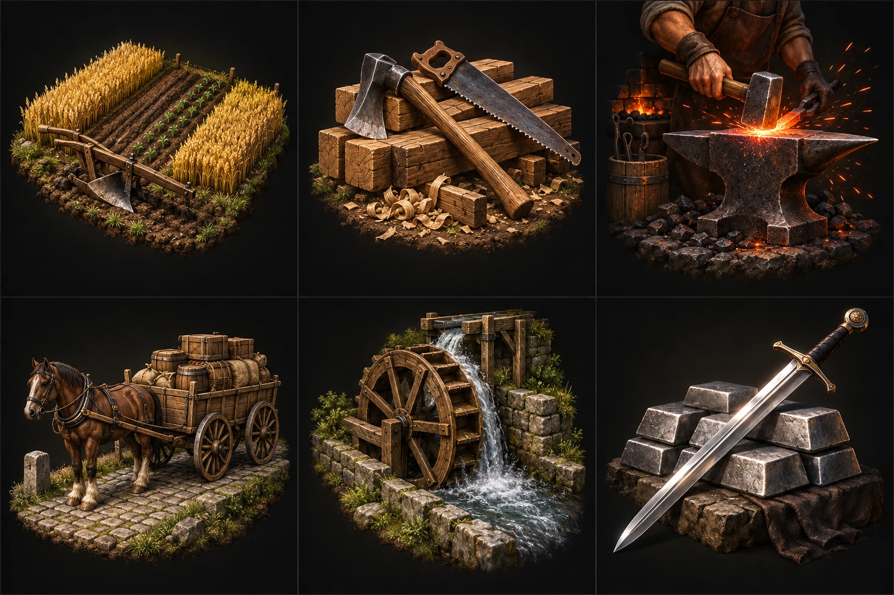

# 《列國征途：始源》美術聖經 Art Bible v1.0

> **版本：v1.0／2026-10-28｜狀態：實際素材盤點後的美術標準候選，待玩家確認｜只限美術，不改 v95 遊戲規則、資產或程式。**
>
> 參考基準：GitHub main commit 844a904e7527b79fd2cd7e2837e78b412aadf1c0。此文件為**獨立美術規範版本**，與完整玩法主規格 v95、遊戲 Release 版號、存檔 schema 各自獨立；未來修訂需另存 Art Bible v1.1／v2.0，不應無紀錄覆蓋本版。
>
> **核心原則：共同世界觀，但不得混淆三種畫面用途。** 城市建築＝斜俯視的遊戲場景 Sprite；軍隊主圖＝深色攝影棚感的歷史兵種卡面 Portrait；科技主要卡圖＝深色工藝靜物插畫。HUD 小符號與科技狀態徽章可採一致的平面向量子系統，不得拿來取代主視覺卡面。

## 0. 查核證據、權威圖片、目前問題

實際從以下 GitHub 圖檔及程式對照，不依照泛用幻想中世紀圖片猜測：

| 類別 | 現有正式視覺參考（Style Anchor） | 已發現的偏離與處理 |
|---|---|---|
| 城市／建築 | [20 格基礎建築圖集](../../public/art/building-atlas.webp)；[封建時代建築](../../public/art/buildings-feudal.webp)；[鐵匠鋪](../../public/art/formal/building-blacksmith.webp)；[修道院](../../public/art/formal/building-monastery.webp)；[城堡時代六文明城市](../../public/art/cities-age-2.webp) | 相對統一為暖色、斜視、材質手繪。少數不同世代的建築明暗／細節密度並不完全相同；新素材須以**實際顯示位置**的同一類子集對照，不得任選一張無關素材。 |
| 軍隊卡面 | [舊兵種 3×2 圖集：民兵／槍兵／弓兵等](../../public/art/catalog-units.webp)；[六文明衛隊卡面](../../public/art/catalog-guards.webp) | **待校準**：[現用戰矛兵](../../public/art/formal/unit-skirmisher.webp)、[現用投石機](../../public/art/formal/unit-catapult.webp)為斜視等距、配小塊地台；與舊卡面「人物全身、近人眼 3/4、黑暗影棚」不同。 |
| 科技卡面 | [舊科技 3×2 圖集](../../public/art/catalog-technologies.webp)（農業、木工、鍛造、運輸、水車、兵器） | 既有部分科技使用具象物件的深色工藝插畫，另一些透過 [tech-administration.svg](../../public/art/formal/tech-administration.svg)、[tech-engineering.svg](../../public/art/formal/tech-engineering.svg)、[tech-siege.svg](../../public/art/formal/tech-siege.svg) 使用「墨綠底／金色線描」。這是**兩種呈現層級混在主卡面**的風格差異，需要分層治理。 |
| 軍隊 HUD 小圖 | [軍隊 HUD 圖示圖集](../../public/art/formal/hud-unit-icons-v03015.png) | 扁平高對比符號本來就是**低尺寸辨識用的獨立系統**；不要求它變成寫實兵種立繪，但整個 HUD 系列需統一筆畫、填色、佔位與透明度。 |

**實際上圖規則（不得只憑檔名猜）：** [artMap.ts](../../src/game/presentation/artMap.ts) 的 unitArt／techArt 及 [Art.tsx](../../src/game/presentation/Art.tsx) 決定兵種、科技如何從 3 欄×2 列圖集或單張資產呈現；[UnitIcon.tsx](../../src/game/presentation/UnitIcon.tsx) 專供小 HUD。新圖若放錯系統，顏色再接近也會顯得不一致。

### 0.1 實際主圖外觀（點圖可看原檔）

**建築母圖：**

**兵種母圖（舊民兵、槍兵在第一列）：**

**目前偏離軍隊卡面風格的新圖片：**

 

**科技母圖：**

這些都是專案內的實際檔案，**不是外部範例或新生成圖**。比對前須在黑、淺、中性色背景各看一次；若透明素材出現紅／黃／黑雜色邊緣，需要額外驗 alpha 與邊緣 RGB 污染。

## 1. 全系列的共通藝術 DNA（所有插畫主圖）

| 屬性 | 統一要求 | 禁止項目 |
|---|---|---|
| 世界觀 | 原創歷史策略遊戲、黑暗→封建→城堡→帝王的技術演進；中／拜占庭／法蘭克／不列顛／日／蒙可保有歷史建築／服裝差異 | 任意魔法光環、動漫角色、大頭 Q 版、科幻零件混進中世紀，除非 v95 正式指定現代軍事分類 |
| 造型 | 介於「細膩寫實」與「經過遊戲可讀性簡化的手繪」之間；主輪廓準確，關鍵裝備與屋頂辨識明確 | 照片直接合成、極端 3D 塑膠 CG、過度銳利的 AI HDR、低多邊形玩具或純二次元 |
| 色彩 | 低至中飽和，偏灰的橄欖綠、泥土褐、赭石、舊木棕、暖灰石、鐵黑、皮革色；旗幟與徽章可小面積暗紅／藍／金點綴 | 整張螢光飽和、寶石玻璃炫光、鮮艷純色背景、所有物件同一塑膠材質 |
| 光線 | **主光從畫面左上方偏暖**、陰影往右下方；柔和接觸陰影，金屬可保留受控高光 | 每張光源位置不同、強烈背光把輪廓吞沒、互相矛盾的影子 |
| 細節 | 保留木紋、石塊、瓦片、布、皮革、金屬與使用痕跡；細節服從縮小後辨識 | 文字、水印、品牌、裝飾邊框、不必要的人物背景劇情、過度複雜的零碎紋樣 |
| 來源 | 優先用專案原圖當**實際可見的圖片參考**；保存來源、提示詞、裁切方式、模型／工具、變更理由與校準截圖 | 只有「模仿世紀帝國」等遊戲名稱；無參考圖自由生成；直接拿第三方遊戲截圖當正式素材 |

**色票屬引導值而不是逐像素硬性校色：** 木材深棕 #60452F、暖灰石 #94836B、屋瓦赭紅 #965A3C、土地 #8A754C、橄欖綠 #606A46、鐵器 #414240、暖金 #C09A5A。實際校色以相應原圖採樣為準，避免不同顯示器或圖片壓縮造成錯判。軍隊黑底背景屬軍隊卡面專用，不得套入城內建築。

## 2. A 系列｜城市建築／城內場景【CITY-BUILDING】

### 2.1 使用位置與視角（LOCK 目標）

- **用途：**城市中心、住宅、兵營、鐵匠鋪、修道院、鑄幣所、加工建築、工地、城牆、田地、世界圖上的文明城。
- **相機：**固定偏高俯視的經典等距／2:1 斜投影語言；大約 45° 方位與 30～40° 仰角（以現有資產視覺對齊為準，不強制所有歷史底圖用數學正交相機）。
- **構圖：**完整建築不裁切、看得到屋頂與至少兩面牆，地面為一薄層泥土／草地接觸區，**不能是厚厚漂浮的方形石台**；物體中心及地腳和現有城市 slot 對齊。
- **材質：**石材略泛暖灰、木材粗糙舊棕、瓦頂低飽和赭紅，木工與礦區可有少量木屑、礦石、布旗；每種文明的建築特色應保留，但共用光源與表現方式。
- **景深：**通常不使用照片景深與背景天空；單棟 Sprite 背景**透明**、有輕微貼地陰影即可。城內場景底圖另按既有 1536×1024 畫面／定位規格保持道路和地格固定。
- **新建築主要 Style Anchor：**public/art/formal/building-blacksmith.webp、building-monastery.webp、building-mint.webp；舊建築槽則另與 public/art/building-atlas.webp／buildings-feudal.webp 並排比較。

### 2.2 檔案／輸出契約

- **單棟正式新增建築：**優先 512×512 RGBA PNG 母檔，核准後可轉 512×512 WebP；現有正式單圖位於 public/art/formal/building-*.webp，原始母檔在 docs/art-source/formal/building-*.png。
- **圖集：**只有在明確需要一批新建築時才排版；多格必須定義整數列數／行數、每格大小、各格 Sprite 對照 ID、真正空白 gutter、實際裁切 rect。**不可相信生圖工具一定輸出提示所要求的尺寸。**早期 building-atlas 的實際格寬不均，已在 docs/ART_V4_PROVENANCE.json 記錄手量 crop，不能擅自均分取代。
- **透明：**真 alpha，角落全透明；去除亮色溢色／硬黑邊；不要烘焙 UI 色塊、文字、白底、棋盤格。每張要檢查在黑、淺灰與遊戲實際地面上。
- **定位：**原有地形背景、建築錨點、道路、施工骨架、城牆裁切與不同時代切換都不得因美術替換而改位。

### 2.3 建築創作提示詞母版（搭配原始圖片附件）

~~~text
TASK: Create ONE ORIGINAL production-ready isometric building sprite for
the existing historical strategy game "Lieguo: Origin".

MANDATORY VISIBLE STYLE REFERENCES (actual image files attached):
1. public/art/formal/building-blacksmith.webp
2. public/art/formal/building-monastery.webp
3. public/art/building-atlas.webp (context only; use the closest building slot)

Match the selected reference's elevated isometric camera, perceived
building scale, roof geometry, earthy hand-painted semi-realistic rendering,
warm upper-left daylight, muted olive/ochre/timber/stone palette, restrained
detail and tiny natural ground-contact patch.

TARGET: [building name, civilization, era, identifying features]
OUTPUT: one isolated complete sprite, 512x512 RGBA with REAL transparency,
centered consistently with the original building sprites. Preserve
unclipped roof, ground-contact point and soft shadow.

AVOID: black studio portrait background, thick raised platform, fantasy
glow, cartoon plastic 3D, photoreal architecture photography, text,
border, watermark, checkerboard, inconsistent angle, saturated neon colors.
Do not change game mechanics or existing assets.
~~~

## 3. B 系列｜軍隊正式卡面【ARMY-PORTRAIT】

### 3.1 風格錨點與禁止混用

**最高優先 Style Anchor：**public/art/catalog-units.webp 第一列第一格（民兵）、第一列第二格（槍兵）；弓兵、騎兵與軍事器械則參照**同一個 3×2 圖集內**相近角色；文明衛隊參照 public/art/catalog-guards.webp。

**核心構圖：**真實人體比例、全身完整、近人眼高度或輕微側上方的 **3/4 英雄兵種卡面**；深黑／深炭灰無場景背景，柔和聚光，衣甲寫實紋理，地面僅能有弱接觸影。不是大頭 Q 版，不是 45° 高俯視，不是站在一塊等距草地方磚上。

- 民兵／槍兵是**軍隊卡面**標準，**不得**以新戰矛兵來反向改動舊兵種群的構圖。
- 長兵器／盾牌可以略出人物輪廓，但武器不得超出卡片可視裁切區；臉、肩甲、主要武器必須縮小後可辨。
- 投石機／衝撞車屬**軍隊名錄裡的攻城單位**時，需用與步兵相同的**暗色背景、相似 3/4 視角、寫實材質與影棚光源**，而非建築 Sprite 的上方俯視或草地基座。若未來世界地圖真的需要攻城器**地圖 Sprite**，那是另一種 asset role，應另外製作，不可復用軍隊卡面來代替。
- 槍兵（spearman）與戰矛兵（skirmisher）要**在武器用途及姿勢上辨識**，不能僅改制服顏色：前者長槍直立／持槍站姿；後者短投矛的預備投擲或肩上投擲動作，身形與鎧甲質感保持同一系列。
- 投石機應辨識木製橫梁、拋射臂、繩索與車輪；不新增厚草地底座；器械在暗背景佔圖約 70～85%，視角接近舊兵種圖集的衝撞車卡片。

### 3.2 優先修復清單

| 優先 | 正式檔案 | 現況 | 建議 |
|---|---|---|---|
| P1 | public/art/formal/unit-skirmisher.webp | 相較舊民兵／槍兵，明顯偏高俯視、持短矛的斜視人物立在草地塊 | **重新生成／編修成暗背景全身卡面**，保留短投矛與盾牌辨識，不改單位屬性、ID 與兵種定位 |
| P1 | public/art/formal/unit-catapult.webp | 斜視機械安置在地台，與舊黑背景衝撞車落差明顯 | **重新生成／編修成同圖集器械立繪**，保留木、繩、輪、石彈但去除地台 |
| P2 | 未來新增兵種／精銳變體 | 若僅用文生圖容易每張換一套視覺世界 | 以第一列民兵／槍兵＋第二列對應兵種做**兩張以上實際圖像參照**，逐件比稿 |

### 3.3 輸出／裁切契約

- 舊圖集 public/art/catalog-units.webp 為 **1536×1024、3 欄×2 列、每格 512×512** 的視覺基準；新單張可用 **512×512 的深炭色背景**（與舊卡面相符），不用硬塞回舊圖集或重新製作民兵、槍兵。
- artMap.ts 的 skirmisher／catapult 目前是單張 WebP 路徑，Art.tsx 以 img 顯示；正式替換要保留 ID、裁切／比例、既有 class 和 alt 資訊，不能改 game save identity。
- 兵種卡面不強求真 alpha（既有舊卡面就是暗背景）。**正式用途不同，透明背景不是一律正確。** HUD 小圖另有透明扁平符號規格。
- 比較時至少將原民兵／槍兵／新戰矛兵及原衝撞車／新投石機並排，並放入**遊戲現有兵種名錄實際卡片尺寸**看清晰度。

### 3.4 戰矛兵與投石機共同提示詞母版

~~~text
TASK: Create ONE ORIGINAL medieval unit CATALOG PORTRAIT, NOT a map sprite.
Mandatory attached style images: public/art/catalog-units.webp
(showing militia, spearman and medieval siege ram), plus
public/art/catalog-guards.webp for materials and studio light.

TARGET: [skirmisher with throwing javelin / wooden stone-throwing catapult].
Historical semi-realistic painterly game character/equipment card.
Full object visible, 3/4 camera from approximately human-eye height,
dark charcoal/near-black studio background, warm soft upper-left key light,
subtle rim highlights, detailed but restrained weathered cloth, steel,
leather, timber and rope matching the reference atlas. Similar scale,
color grading and silhouette occupancy as the matching reference cell.

OUTPUT: one square 512x512 final game card image. No frame or text.
For skirmisher, visibly distinct shorter THROWING javelin and athletic
ready-to-throw pose. For catapult, readable throwing arm, cup, stone,
rope, wooden frame and wheels; match the old ram-card lighting.

STRICTLY DO NOT: isometric top-down game piece, grass/diamond ground tile,
black matte under a separately rendered building sprite, cartoon/anime,
bright red-yellow alpha fringing, fantasy glow, modern weapon, thick
concept-art scenery, different art medium, watermark, UI panel.
Preserve the old militia and spearman art unchanged.
~~~

## 4. C 系列｜科技正式卡圖／科技小符號【TECH-ART】

### 4.1 區分兩種角色，不應混成同一種素材

| 角色 | 定位與目標風格 | 參考 |
|---|---|---|
| **TECH-CARD（正式科技大卡圖）** | 與早期科技圖集一致：深炭背景、單一研究主題的具象歷史工藝靜物／小型工作場景、3/4 角度、暗色寫實手繪、暖光。呈現科技**內容**而非只用抽象符號。 | public/art/catalog-technologies.webp |
| **TECH-SYMBOL（狀態／小尺寸符號）** | 讀性優先的 SVG 扁平線描，墨綠底、古銅金框與象牙金線條；適合迷你圖、工具列、狀態提示與 fallback。 | public/art/formal/tech-*.svg |
| **HUD-UNIT（軍隊 HUD）** | 彩色分類標記，屬**另一套** HUD 系統，不應與 TECH-SYMBOL 混為一組。 | public/art/formal/hud-unit-icons-v03015.png |

**現狀負債：**artMap.ts 的 techArt 同時回傳科技圖集與 160×160 SVG 作為卡片主圖，因而讓某些卡片變成「立體寫實工藝圖」、某些變成「線條圖示」。**本版只定義方向，尚未授權把所有科技批次重生。** 後續如需一致卡面，應分批優先補齊 TECH-CARD，保留 TECH-SYMBOL 的小尺寸與 fallback 用途；不得悄悄更動科技資料、研究成本、階級或效果。

### 4.2 TECH-CARD 規範

- **構圖：**單一視覺焦點，3/4 斜視角的實物／工坊局部、深炭背景；佔畫面約 60～80%，避免不同卡圖有的物件過小、有的被截斷。
- **光線：**左上暖光、受控的金屬反射、厚實木材、繩索、紙卷／量具等舊世界工藝感；農田用柔暖草金色，鍛造容許小面積橘色火光但不蓋滿。
- **語意：**農業＝田／農具；木工＝鋸與木料；採石＝石塊與手工具；採礦＝礦車／礦石；攻城＝器械機構；行政＝文書與印璽；情報＝地圖與望遠器；軍事＝相應武器；不可不加區分地使用同一把劍或同一棟學院。
- **I／II／III：**用正式 UI 羅馬階段徽章表示研究階數，不必為三級科技生三張風格漂移的圖片；若日後另生各階卡圖，要延續同一類核心主物件，隨階次循序增加工藝細節。
- **規格：**沿用 512×512 卡面安全裁切（舊圖集是 1536×1024／3×2），單張圖片可獨立儲存再映射；不得依賴提示詞保證圖集尺寸與隔線精準，實際裁切須驗證。
- **禁止：**3D 塑膠圖示、漂浮霓虹技能珠、科幻能量球、大量文字數字、深色科技卡面中忽然出現亮底扁平 vector 插畫。

### 4.3 TECH-SYMBOL 規範（保留已存在 SVG 體系）

取樣自現有 SVG 的**實際程式碼**，而不是新猜的設計系統：

| 色彩／規格 | 現行值 | 作用 |
|---|---|---|
| SVG 畫布 | 160×160，viewBox 0 0 160 160 | 科技子圖示 |
| 深綠底 | #24362c | 160px 卡片符號底 |
| 古銅外框 | #8e7545，外框 stroke 3 | 系列感與邊界 |
| 裝飾線 | #756340，約 stroke 2 | 周邊輕裝飾 |
| 主線條 | #dfc080，約 stroke 2.7（內部圖形有縮放） | 圖像筆畫 |
| 圓角 | 外底 rx 24 | 全部科技向量統一 |

新 SVG 須保持同樣底框、內部留白、線帽 linecap=round、線段 join=round、同一線寬視覺密度；禁止每張自訂全新底色、漸層、高光或完全不同的描邊語言。SVG 不得內嵌外部連結／腳本／字型。

### 4.4 科技大卡圖生成母版

~~~text
TASK: Produce ONE original historical research TECHNOLOGY CARD ILLUSTRATION.
ATTACH actual visual anchor public/art/catalog-technologies.webp.
Render a tangible medieval research subject or work-process object,
not a minimalist line icon. Match the reference's dark charcoal studio
background, richly textured semi-realistic painterly still-life,
warm upper-left lighting, muted earthy palette and 3/4 viewpoint.

TECHNOLOGY: [exact name / research effect / key visual object].
Center one instantly recognizable craft scene or tool group with
generous safe margin, square 512x512 output, no labels, frame or text.
No futuristic UI, neon skill orb, cartoon outline or floating toy.

Keep I/II/III as UI overlays, unless explicitly asked otherwise.
Preserve game tech IDs, data, effect, cost and research prerequisites.
~~~

## 5. 資產角色與風格檢查表（不可互相代用）

| Asset role | 背景 | 視角 | 主檔推薦 | 正式用途 |
|---|---|---|---|---|
| CITY-SPRITE | **真正透明** | 斜俯視等距／2:1 語言 | 512×512 RGBA → WebP | 城內建築、獨立城郊資源點 |
| CITY-SCENE | 完整景觀 | 高角度等距、道路錨點固定 | 既有 1536×1024 規格 | 城內大場景底圖 |
| ARMY-PORTRAIT | **深炭色暗背景** | 人眼附近的 3/4 全身／器械卡面 | 512×512 | 兵種名錄、單位資訊卡 |
| TECH-CARD | **深炭色暗背景** | 3/4 具象工藝靜物 | 512×512 | 正式科技名錄大卡圖 |
| TECH-SYMBOL | 墨綠底／銅框 | 正面符號 | 160×160 SVG | 迷你研究圖示、提示與 fallback |
| HUD-UNIT | 真透明 | 平面正視符號 | 保持現行 HUD 圖集切片 | 駐軍統計列，不是卡面 |

**關鍵驗收陷阱：**只有「看起來是中古風」、「用土色」、「用同一個工具生成」不代表風格一致。**軍隊卡面如果出現草地方塊，即使細節漂亮，也視為不符合 ARMY-PORTRAIT 規格。**

## 6. Codex 以後新增圖片必遵守的流程（ART-GATE）

### 6.1 生圖前（禁止只依文字自由發揮）

1. 明確宣告 asset role：CITY-SPRITE／CITY-SCENE／ARMY-PORTRAIT／TECH-CARD／TECH-SYMBOL／HUD-UNIT。
2. 從本檔挑至少 **兩張真正現有圖片**當**Style Anchors**；同類優先。例如新增戰矛兵一定同時拿民兵、槍兵；新增投石機至少拿舊衝撞車與舊兵種人像；不允許只引用檔案路徑但實際圖片沒有進生成器。
3. 記錄欲取代的 **正式 artMap／assets ID 與畫面用途**、目標實際尺寸、裁切方法、原背景顏色、資產名稱、輸出路徑及是否需要真正透明。
4. **先只生候選圖，不能直接覆蓋已上線資產。** 建議初稿各 2～3 張，風格對齊選出 1 張後，再處理尺寸、去背、壓縮、入版。
5. 生成器若不支援參考圖片輸入，**不得宣稱已做圖像參考的一致性生成**；應改用支持參考圖的工作流程或把結果標記為僅概念候選。

### 6.2 正式審查 Rubric（每項 0／1／2；滿分 20）

| 檢核 | 0＝明顯不同 | 1＝部分符合 | 2＝符合 |
|---|---|---|---|
| 01 正確 asset role | 用途不符 | 偶有混用 | 使用情境完全吻合 |
| 02 相機／視角 | 不同 | 相近 | 與對照樣本一致 |
| 03 比例／佔位 | 明顯大小漂移 | 可微調 | 貼合原卡片／建築格 |
| 04 光線 | 相反方向／過戲劇 | 可用但不一 | 左上暖光一致 |
| 05 影調／飽和 | 亮霓虹／黑底錯誤 | 略偏 | 與錨點同類 |
| 06 材質 | CG 塑膠／照片拼貼 | 質感略異 | 手繪寫實統一 |
| 07 風格筆觸／細節 | 寫實程度完全不同 | 小差異 | 同一系列 |
| 08 角色／物件辨識 | 小尺寸無法辨識 | 偶需猜測 | 64px 下也清楚 |
| 09 技術畫布／透明／裁切 | 裁切、底色／alpha 錯 | 輕微修邊 | 尺寸＋背景完全符合 |
| 10 正式 UI 效果 | 遊戲畫面明顯突兀 | 有些偏移 | 和既有卡面／城建並排自然 |

**門檻：**建議至少 **17/20** 才可列為「美術待核准候選」；**第 01、02、09 項任一 0 分直接退件**，不因總分高而例外。最終仍須玩家確認；這是**設計 Gate，不是已建置自動測試**。

### 6.3 程式化技術 Gate（建議 Codex 新增，不視為現成）

- 確認 PNG／WebP／SVG 檔可解碼，預期寬高／畫布與檔案命名一致。
- CITY-SPRITE alpha 角落必須透明；檢查 alpha 範圍及不正常的紅／黃／黑像素外緣，檢查材質在實際地景與灰底。
- ARMY-PORTRAIT／TECH-CARD 不能有等距草地平台、不能有 UI 字／水印；這是人工／視覺模型審查，不假裝能只用像素腳本完全判定。
- 若使用 atlas，保留正確切片與排序；新增單圖需確認 artMap 路徑、現有 Art 元件呈現比例、元件 Alt／標籤正確。
- 產物要保留原始母檔與 WebP 衍生檔、來源說明與生成提示詞；不能寫入來源不明的第三方圖。具體的技術 QA 可以新增最小腳本，但**不得因此調整任何遊戲平衡或存檔 schema**。
- 以桌面及 320／390px 手機實際畫面／Canvas 做並排視覺驗收；64px 及遊戲正常卡片大小都要看。只有 DOM 測試不算畫面風格 PASS。
- 任何正式圖像替換都需獨立 Git 分支／Draft PR，附「原圖→候選圖→正式 UI 對照」，玩家核准後才能併 main 或由既有 Pages 流程發布。

### 6.4 必保存來源資料（建議欄位）

- assetId、role、logicalUnitOrBuildingOrTechId、sourceImagePaths、referenceAnchorPaths、prompt、generationToolAndModel（如可得）、sourceDimensions、outputDimensions、alphaPolicy、cropRects／atlasIndex、checksum、artGateScore、approver、createdAt、PR、migrationNotes。
- 若是「重畫相同 ID」，需記錄**原檔 SHA**及新 SHA，方便日後 revert；圖片是否有透明背景／暗色背景必須記錄。
- 未經核准不得暗中取代已上線的舊民兵、槍兵、科技卡面或現有六文明建築母圖。

## 7. 既有問題修復順序（本檔不施工）

**P1｜先處理軍隊視覺裂痕：**重製戰矛兵及投石機的**單位卡面版本**，以舊民兵、槍兵、衝撞車為固定 Style Anchors。建議保留現有斜視圖作候選**地圖 Sprite**（只有當遊戲真的需要該類地圖單位圖時），而非直接丟棄美術成果。

**P2｜統一科技大卡面：**先盤點 techArt 中回退到 tech-*.svg 的科技種類，製作 3～6 張具象深色工藝科技卡面做樣本；維持 SVG 作小符號，核准後再分批擴充。

**P3｜城市建築細節：**新建築必須先和現有鐵匠鋪／修道院／鑄幣所並排；如果發現不一致，應做局部校色、修邊、大小與基座比例調整，而不是一次性重繪所有已經一致的建築。

**P4｜建立校準圖板：**每一大類維持「核准母圖 2～3 張＋同規格近期新圖」的橫向比稿板。比稿板是**品質證據**，不是新的遊戲資產；避免往後 Codex 無參考自由生成。

## 8. 本版狀態與不變邊界

- **已做：**對照 GitHub 現有實際圖像、src/game/presentation/artMap.ts、Art.tsx、UnitIcon.tsx、docs/ART_V4_PROMPTS.json、docs/ART_V4_PROVENANCE.json 等歷史美術提示與來源，建立三類母圖、兩種科技呈現及一致性檢核表。
- **尚未做：**沒有重新生成任何兵種／建築／科技圖片；沒有修改 public/art、src/game、遊戲主規格 v95、Pages 或 AI 規則；未聲稱通過遊戲內實機視覺 Gate。
- **效力：**本文件的 Style Anchors 與工作流程作為新的候選美術審查標準；後續玩家核准後再由 Codex 以獨立 PR 執行替換。**沒有任何一張舊美術圖因本文件而自動成為要刪除／重畫的目標。**
