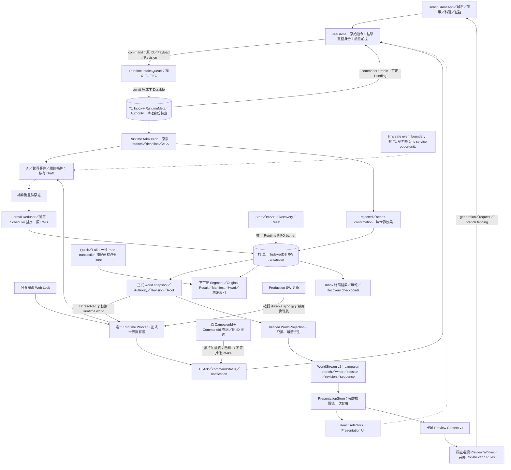

# B10 Final：權威、交易與訊息邊界

審查來源：`8d40f63c5efbd08ee252f533719d5f58fc95b3dd`，完整包含 R3-01～06。以下描述正式產品路徑；測試 harness 的合成時鐘、故障注入及觀測 hooks 不屬於遊戲規則。

## 模組與權限

| 模組 | 權限、狀態與限制 |
|---|---|
| `src/game/useGame.ts`、`GameApp.tsx` | 形成原命令與 UI 狀態，保存點擊當下的 Presentation identity／語意前提；無正式 Reducer 或 DB 世界寫入權。Created 不等於 Durable。 |
| `saveLock.ts` | 取得同 Origin 的 `lieguo-formal-ledger-v1-writer` 獨占 Web Lock 後建立權威 Worker；8 秒等待有明確回饋，不偷鎖。 |
| `runtime.worker.ts` | 唯一正式熱世界；前景命令與控制操作 FIFO、coalesced tick。T1 與結果查詢可在私有補算的安全讓出點處理，世界不在中途公開。 |
| `runtimeWorkBudget.ts` | 正式事件完成後讓出；預設 8ms，T1 pending 時 2ms 檢查、開始 draft 前請求 4ms opening。timer 不是硬即時保證，單一 AI／戰鬥原子事件仍可能超時。 |
| `durableCommands.ts`、`orderAdmission.ts`、`governanceAdmission.ts` | 保存原 Payload、Revision、issuer、指令 fingerprint、branch／epoch 及原意。允許的 passive bridge 依既定契約重驗；不自行換目標、數量或 CommandId。治理 ABA 有最後寫入身份。 |
| Formal Reducer／Scheduler／AI | 僅生成候選世界、結果、事件與戰報；正式生效需要 T2。補算後再次驗證原命令，AI 排程優化不刪事件、不改 RNG／tie-breaker 或正式玩法。 |
| `persistence.ts` | T1／T2、Authority、Writer epoch、Revision／Root CAS、分支切換、Recovery、備份唯一正式路徑。回傳 committed world 前交易必須完成。 |
| `ledgerStore.ts`、`formal/commandLedger.ts` | Segment／Result hash chain、Manifest 綁定、精確 persistent AVL reader、Original Result 永久不覆寫。查詢 disposition 與原結果分開。 |
| `worldProjection.ts`、`worldStream.ts` | 只能從已提交、已驗證且 branch／revision 綁定的 world 產生畫面；不傳 receipts、Events、AI 或完整帳本。不是另一套 FormalWorld。 |
| `presentationStore.ts`、selectors | 驗證 campaign／branch／writer／session、base／next revision、單調 sequence、entity／section versions；整包拒絕失配，成功後才通知 React。 |
| `constructionPreview.worker.ts`、Controller | 單城 Context、共享純建造規則，無 Authority／Inbox／Recovery／IndexedDB 寫入能力；結果按 generation／request／scope 篩選。預覽失敗不取消或重送正式命令。 |
| `useAppUpdate.ts`、VitePWA | 核對 Worker 自身 build／content 身份，等待真正 durable sync，才 SKIP_WAITING、controllerchange、導航。保存失敗不可回報成功。 |

## 玩家命令生命週期

1. UI 建立原始 `FormalOrder`，標示 Created；以 React 已提交畫面擷取 campaign／branch／writer／revision 與語意。尚未完成 T1 的操作沒有持久承諾。
2. Runtime 收到後立即確認 received，將 T1 放入獨立 intake FIFO。`receiveCommand` 先 strict parse，再於小型 RW transaction 保存原 order／intent／sequence／deadline。CampaignId＋CommandId 唯一；相同 ID 不同 issuer／fingerprint 拒絕。
3. T1 完成後才送 `commandDurable`。此時可查 Pending；即使 Worker 終止、頁面關閉或 Ack 遺失，原身份與 Payload 仍在 IndexedDB。
4. 正式前景 drain 按持久 sequence 執行。先查終局身份；已存在結果直接回覆。驗原 branch／前提／deadline，推進正式先行事件至固定目標時間，之後再驗原意。私有 draft 不可展示為正式狀態。
5. Reducer 生成結果後，T2 同時保存正式世界、Ledger／Original Result、Manifest／Head／Index、Authority、Inbox 結果、戰報與 Recovery。無效果拒絕也保存不可覆寫的結果與 Root；不能以未提交 draft 回 Ack。
6. T2 resolved 才發布 committed world 與 T3 Ack／Projection。`postMessage` 或 UI 套用失敗不會撤銷 T2，也不會啟動第二次正式效果。
7. 已知 ID 查詢不等不相干 intake；未知 ID 等待之前 T1，避免誤報不存在。讀取若跨世界／writer 發布會有限重讀；不把舊 Pending 覆蓋新 Ack。UI 可經有界自動查詢／手動入口取得原結果。
8. 暫時 Abort／Timeout 依原期限與最多三次嘗試處理；Quota、CAS、規則拒絕不盲目重試。Recovery 後同身份可 rolled-back，但 Original Result 不被抹除，舊 ID 不再生效。

**整合差異須如實解讀：** R3-01 歷史「T1 不讀 current 世界 row」不是最終格式的驗收斷言。R3-03 後 T1 讀取熱世界 anchor／Authority／Manifest header 與單一精確身份，以確認當前 Root；沒有序列化或掃描整份歷史。舊 native harness 假定 `state.world` 的 v1 訊息，不能直接拿來宣稱最終 v2 PASS。本輪使用目前的 Ledger／Projection／Runtime native harness 與全部定向測試。

## T2／Ledger／Recovery 資料流

普通有世界效果的 T2 包含 `saves`、`backups`、`BattleReports`、`Inbox`、`RuntimeMeta` 與全部 Ledger tables。`finishCommand` 的無效果 T2 保存 Inbox、world anchor／checksum、Authority 及 Ledger 結果，保持同一世界 Revision。不能以 Revision 相同推論 Root 相同。

Writer epoch 先比對持久 metadata；普通 save 再比對世界、Authority、LedgerHead、Root、checksum 與 expectedRevision。候選世界先隔離、完整 schema／checksum 驗證；所有交易內寫入失敗都應回滾。Crypto 以 Dexie waitFor 保持同一交易，不拆成先報成功、後補帳本。

讀檔先驗不可變 Ledger、Manifest chain、原始結果與精確身份，再驗世界／Authority／Head／growth facts。派生 Index 或 current snapshot 損毀可以選有效 checkpoint 做原子 Recovery；不可變 Segment／Result／Manifest 損毀則安全拒絕並保留原資料，不能靠 warm proof 掩蓋或自動清除。

Quick／Full 都從一致 read transaction 捕捉目前 Head、必要 Recovery roots、所有原身份／拒絕結果、Inbox 與永久任務證據；Full 另保留戰報。編碼在 read transaction 外對不可變資料執行。100MiB 上限仍在；拒絕大型檔案不等於資料遺失，發布前仍須明確決策容量限制。

Recovery／Import／Start／Reset 由 Runtime 控制 barrier 串行執行，等待查詢視圖穩定；同一 T2 關閉舊 Pending、保存舊身份、更新 branch／writer／Authority。重新載入後依 sequence 恢復 Pending，不產生新 ID。React layout scope 清除舊戰役草稿，Preview 及 Stream 的 branch fencing 排除晚到回覆。

## UI／Preview 與快取

Ack 高於畫面 revision 時，最後一個 frame 遺失會在首筆期限約 250ms 啟動有限唯讀 snapshot recovery；新 Ack 不延後期限。若 Ack 也遺失，既有每筆查詢／恢復入口查回終局結果，不重送不同 ID。Stream 的同 Revision 更新仍依單調 sequence 檢查。

Preview Controller 上限 64 批 cache，每 channel 只保留最新工作；關閉／切 scope 清理。Verified Ledger 強參照 cache 上限四個 roots，額外 proof bindings 為 WeakMap／WeakRef 及 FinalizationRegistry；LedgerReadSession 只在同一個實際 IDB transaction 存活。Projection 保留當前 proof 與按城市的衍生資料、Stream 保留上一份畫面，React 訂閱可解除。

上述界限不等於總儲存無上限：不可變身份、歷史、Manifest 與跨戰役證據按可靠性契約持久累積；WeakRef 清理由 GC 排程，不能宣稱固定時間釋放。10 分鐘 soak 與獨立 retained-heap 診斷只支援各自量測窗口，不能外推數天運行或 Android 記憶體壓力。

## 六階段交互檢查

| 交界 | 必須保留的契約／本輪驗證方式 |
|---|---|
| R3-01 → R3-03／05／06 | T1 不等完整 AI、原 Payload、查詢身份；T2 一次效果與原子結果；耐重啟／Ack 遺失／CAS。用 Durable、Ledger、Runtime scheduling 測試及 native faults。 |
| R3-02 → R3-04 | Context 使用 presentation world，純建造規則與正式結果一致；不能為了 preview 引入寫入能力。用 Preview boundary／規則／React 與真 GameApp 建造。 |
| R3-03 → R3-04 | UI 不再取得帳本；治理 ABA、任務永久事實、城堡文明來源仍由已驗證的精確依賴衍生。用 Projection admission／scope／army／selector 測試。 |
| R3-03 → R3-05 | 證明重用必須核對全部 bytes／shape，keyset 精確身份與同 transaction row 重用不改格式、Root、Original Result。用損毀／Quota／全部 T2 邊界及相容測試。 |
| R3-04 → R3-06 | 補算中結果查詢與 Projection 只讀 committed source；Recovery 不發布新世界配舊 branch，延遲 Pending 不覆蓋終局。用 scheduling race、lost-frame 與 native restart。 |
| R3-05 → R3-06 | Runtime cooperative yield 不拆 T2、不繞過 Ledger／Save 驗證；離線也遵守相同 budget。31 組固定 PR58 Reference 對照＋transaction successor 固定。 |

DB `lieguo-formal-ledger-v1`、Dexie 3、Save `lieguo-formal-ledger-save-v1`、WorldStream v2；Native ruleset `v97-p0c10.1`、content `lieguo-formal-p0c10-time3`、generator `formal-world-384-v1`、terrain 3，與 appVersion 分開。沒有重新加入 R3-03 前 migration；舊 DB 維持獨立、明確不相容且不覆寫。
