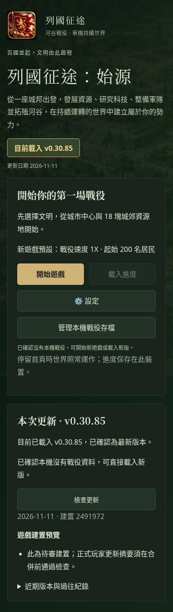
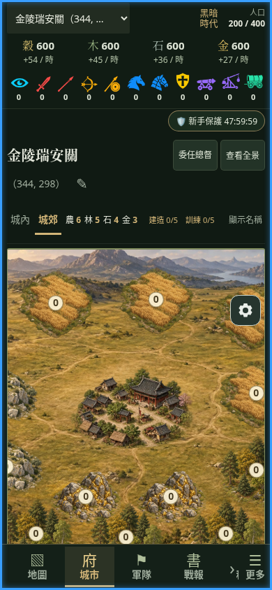

# 首頁、美術準備與精簡遊戲 UI 驗證

Base：`db63881e2ffd617259d736e2c66342de791b331d`（最新 main，含 PR #62）。可玩內容 anchor：`249197226a02863e01a400d1616ccca786d2a5bd`；測試與有限來源後繼 anchor：`9428b9cad8dbfafa929b5a5f9efde33bdb4bf3a2`。完成後停在 Draft PR，未合併、未部署。分支預覽版本由既有 release metadata 產生，沒有手動調高 package baseline。

## 四項改動

- `FormalHome.tsx`、`game.css`：第一排「開始遊戲／載入進度」，第二排設定，第三排獨立存檔管理。管理入口在引擎失敗、載入期間及另一分頁持鎖時可使用；未放入設定視窗。
- `artInventory.ts`、`artUrl.ts`、`artLoader.ts`、`ArtLoading.tsx`、`Start.tsx`、`GameApp.tsx`、`vite.config.ts`：首頁啟動共用圖片佇列，並行上限 2；共用 UI、初期場景與圖集優先，選擇文明後提高該文明優先序。首屏等待集合由實際城市、時代、資源等級與施工狀態決定，建立後不擴大分母。其餘圖片繼續背景下載。每次請求 15 秒期限，失敗不自動無限重試；玩家重試時重新取得失敗圖片，避免沿用 HTTP 503 快取。背景僅下載，不建立大量 Image 或同時解碼所有美術。
- `GameApp.tsx`、`CommandFailure.tsx`：移除命令收件匣、徽章、待處理數量與長期固定錯誤按鈕。舊 `CommandInbox.tsx` 僅保留空模組。只有未接收、無法確認或需要重新確認的操作顯示恢復對話框；原始命令、查詢、原命令重試與重新載入恢復 API 保留。
- `ProtectionStatus.tsx`、`playable.css`：盾牌只顯示類型與現實時間倒數，點擊展開世界／現實剩餘時間及規則，外部點擊、Escape 或關閉均可收合。使用既有 display clock、protectionUntil 與 effectiveSpeed；保護到期／提前解除後隱藏。元件保留一條窄列，詳情浮於其下，避免盾牌遮住城市場景、手機底導與齒輪。

`LocalCampaignManager`、Writer Lock、IndexedDB 刪除／確認、useGame、Runtime、Durable Inbox、T1／T2／T3、Replay Fence、Reducer、Scheduler、AI、存檔格式、保護規則及所有 public/art 圖檔逐位元保留。新增 CI successor 只接受 immutable commit 中明列的 UI／圖片及其測試差異；舊 proof、未知 predecessor 拒絕與反竄改測試保留。

## 正式資產清單

[art-inventory.json](art-inventory.json) 列出 307 個正式 URL、大小、SHA-256，以及排除的 75 個舊版／未使用 URL。原 `public/art` 共 382 個檔案、72,260,827 bytes；正式清單共 57,660,465 bytes（54.99 MiB），沒有內容相同的重複檔案。

清單列舉正式 catalog／registry 與動態路徑：六文明、四時代、建築／施工、資源地等級、城內／城郊、文明及兵種圖集、所有兵種與科技、世界地圖材質及報告圖片。測試實際渲染六文明 × 四時代 × 完工／施工的 sprite，並渲染全部兵種、科技、城市首屏與 Shell，確認其 URL 均有覆蓋且實體檔案存在。未把所有 382 張視為必要。

圖片 URL 使用每個檔案內容的 SHA-256 指紋；有效 CacheStorage／HTTP 快取優先使用。Workbox 不再 precache `art/**`，與程式預載共用 `lieguo-art-content-v1`。更新只改變內容異動檔案的 key，容量壓力下遺失的圖片可增量補載。安裝新 SW 時可將 MD5 符合目前內容的舊 Workbox 圖片轉入新快取，避免首次換策略重抓；既有舊快取可遷移 382 張，但首頁只排程正式 307 張，未下載被排除的 75 張。Workbox runtime 路由以 800 entries 的 LRU 設定管理其載入的圖片；不清除玩家 IndexedDB、設定或其他應用快取。Release Identity 回覆、安全保存後更新及版本確認機制未改動。

## 實際量測

Chromium 154.0.8037.57、Linux、production build、原生 Worker／IndexedDB／Web Locks／Service Worker，使用合成戰役及全新瀏覽器 context。伺服器記錄實際送出的 HTTP **回應內容 bytes**：文字 gzip、圖片依原格式；**不含 HTTP 標頭、請求標頭及 TCP 開銷**。CacheStorage／HTTP cache 命中不計為網路傳輸。以下「資源原始大小」另外列出，沒有把它當作 Network 傳輸量。這是本機 HTTP 測試，不能外推 Android 真機或行動網路延遲。

| 項目 | 修改前 | 修改後 |
| --- | ---: | ---: |
| 首次首頁，背景準備／安裝完成的回應內容 | 75,419,992 B（71.93 MiB） | 60,323,358 B（57.53 MiB） |
| 其中圖片回應內容 | 72,803,279 B／383 次 | 57,660,269 B／307 次 |
| Workbox manifest 條目（含重複 icon） | 395 | 14 |
| Workbox 不重複 precache entries／實際 cache keys | 394 | 13 |
| Workbox 資源原始大小 | 74,875,327 B（71.41 MiB） | 2,696,001 B（2.57 MiB） |
| 首頁程式背景排程 | 無獨立管理器 | 正式清單 307 張，並行 2 |
| 圖片已準備後，確認開局至首屏完成 | 1,772.7 ms | 1,120.2 ms |
| 同版本第二次首頁圖片網路內容 | 0 B | 0 B |
| 同版本第二次進城圖片網路內容 | 0 B | 0 B |

同版本第二次首頁整體回應內容為 65,020 B（版本檢查等非圖片請求），進城額外 0 B；沒有顯示圖片讀取動畫。另在首頁尚未全部準備完就進城，桌面為 2,108.2 ms、手機為 2,271.8 ms；進城時分別只完成 80／307、101／307 張，證明沒有等待全部文明與時代。這些單次時間包含世界建立、必要圖片與畫面顯示，不是純下載 benchmark，也不宣稱引擎效能變更。

- 真實失敗／重試：刻意讓一張首屏圖片回應 503，畫面為 **7／8、剩餘 1 張、87%**；8 張固定集合的已完成數與 CacheStorage 核對一致。重試成功自動進城，當時背景僅完成 36／307 張。沒有以圖片錯誤冒充引擎錯誤。
- 缺少快取：移除一張必要圖片並清除 HTTP cache 後，只下載該張，501,690 B；其他圖片命中快取。
- 從舊 main Workbox 更新：使用遊戲既有「保存進度並載入新版」流程，圖片網路下載 **0 B／0 張**；原戰役、玩家設定與無關 CacheStorage sentinel 保留。
- 新增／變更：隔離的合成 production 版本新增一張 SVG、變更一張 SVG，只下載 **2 張、342 B**；其餘既有圖片 key 保留。這兩張測試變更從未提交至開發分支或 PR。
- 離線：已快取首頁與城市可重載並顯示必要圖片；完成版本更新後再離線進城亦通過。

詳細數值、固定首屏集合與檢查結果見 [measurements.json](measurements.json)。可重跑 `scripts/verify-home-art-browser.mjs`；[verify-updates.mjs](verify-updates.mjs) 驗證官方保存／更新流程與增量下載（Playwright 路徑請依環境調整）。

## 玩家畫面與異常恢復

Production Chromium 1440px 桌面與 390×844 手機均核對四個首頁按鈕座標：開始／載入同排，設定在下，存檔管理再下一排且與設定同寬、同 X。設定視窗中沒有存檔管理，沒有水平溢出。

- 正常改名提交後，原生 Inbox 記錄為 committed；重新載入後城名保留。畫面與重載後都沒有命令收件匣。
- 刻意讓原生 IndexedDB 接收命令失敗，玩家得到恢復對話框；原命令重試後只產生一筆 committed 效果。
- 盾牌現實倒數、詳情開合、外部點擊、Escape、新手／復國種類、合成短保護自然到期、已到期與提前解除均通過；世界資料不被元件修改。
- PR #62 原生 production 恢復測試 14 個案例全部通過，包括 30 秒逾時、Worker 錯誤、取消讀取、不相容／損毀存檔、舊 Writer Lock、blocked／partial IDB 刪除、T2 quota rollback，以及設定／無關資料／快取／SW 保留。首頁按鈕 selector 配合新文字更新；另讓測試專用空白診斷分頁繞過 SW navigation fallback 並斷言其 title，避免診斷頁意外啟動遊戲並取得 Writer Lock。實際遊戲分頁仍使用 SW；原有資料安全斷言與期限未放寬。根目錄與 Pages 版本均 14／14 通過，見 [startup-recovery.json](startup-recovery.json)、[startup-pages.json](startup-pages.json)。

| 390px 首頁 | 390px 城市首屏 |
| --- | --- |
|  |  |

其他截圖：[必要圖片失敗及真實進度](after-390-loading-error.png)、[盾牌詳情](after-390-protection.png)、[離線城市](after-390-offline.png)、[桌面首頁](after-1440-home.png)、[桌面城市](after-1440-city.png)。

## 技術檢查與保留事實

- Typecheck、root／Pages production Build、Pages 路徑、Release／Worker identity 及 explicit activation lifetime：通過。
- 完整隔離回歸：**2545 PASS／0 FAIL／1 SKIP**，執行 `node scripts/verify-in-isolation.mjs full`，未直接在歷史驗證樹執行測試。
- 定向 UI／資產／城牆測試：22 PASS／0 FAIL；城牆由檔案內容獨立計算完整指紋 URL 再精確比對，其他原有規則、隊列與退款斷言保留。
- Production Chromium：8 項玩家體驗檢查、3 項 SW 更新／離線檢查、14 項原生啟動／存檔恢復檢查在根目錄及 Pages 各通過一次。
- GitHub CI、Pages 路徑、Release／Worker identity 與完整來源安全檢查，以本 PR 最新 HEAD 的 checks 及 [checks.json](checks.json) 為準；不以舊 SHA 的 CI 結果代替。

首輪完整回歸的 18 個失敗沒有刪除或隱藏：[regression-attempt1.json](regression-attempt1.json)。其中 8 個為舊的無版本 URL 期望，已改為精確比對完整版本 URL；10 個為高並行驗證負載下的既有期限失敗。保留原期限及工作量，在降低同機並行負載後重跑完整 suite 得到上述 2545／0／1，不以單檔重試代替完整回歸。Pages 恢復測試早期亦發現 SW 將空白診斷頁導回遊戲的 fixture 問題；觀察到的是正確的 Writer Lock 拒絕，deleteDatabase 呼叫為 0。測試診斷頁隔離後，全部 14 案例通過；兩次原始失敗結果保留在 [startup-pages-harness-attempts.json](startup-pages-harness-attempts.json)。

歷史 AGENTS 提到的 legacy art failures、B5 E1 HOLD、Astra Gate 未 PASS 與真機待驗仍是既有歷史事實；本批通過不追改或覆寫歷史驗收紀錄，不宣稱正式 release acceptance。

## 剩餘風險

沒有 Android 真機驗收。尚未確認實際裝置的 PWA 安裝／背景回收、低記憶體解碼、磁碟 quota、系統清除快取、真實行動網路／省電行為。首次仍會在背景準備約 55 MiB 正式美術；並行下載控制及非必要圖片不阻擋首屏不代表沒有流量。瀏覽器仍可自行回收快取，已驗證單張遺失時補載；儲存 API／quota 不可用時退回一般 HTTP cache，不保證永久離線可用。
