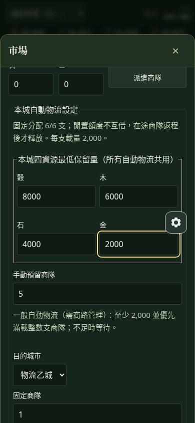
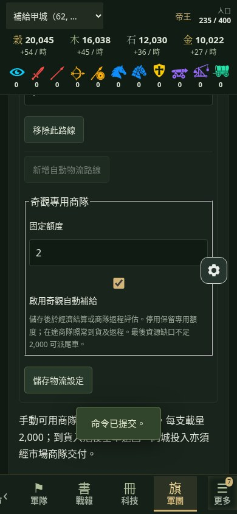
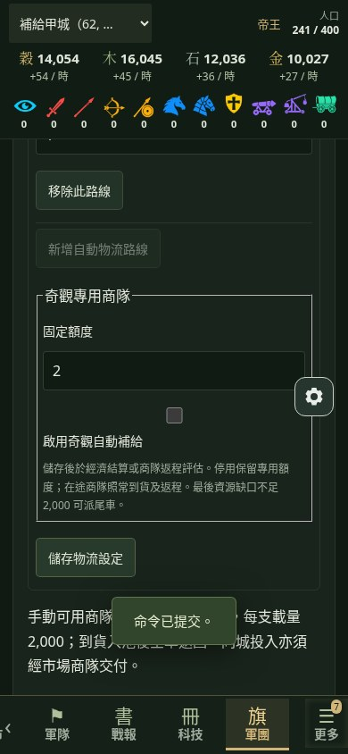
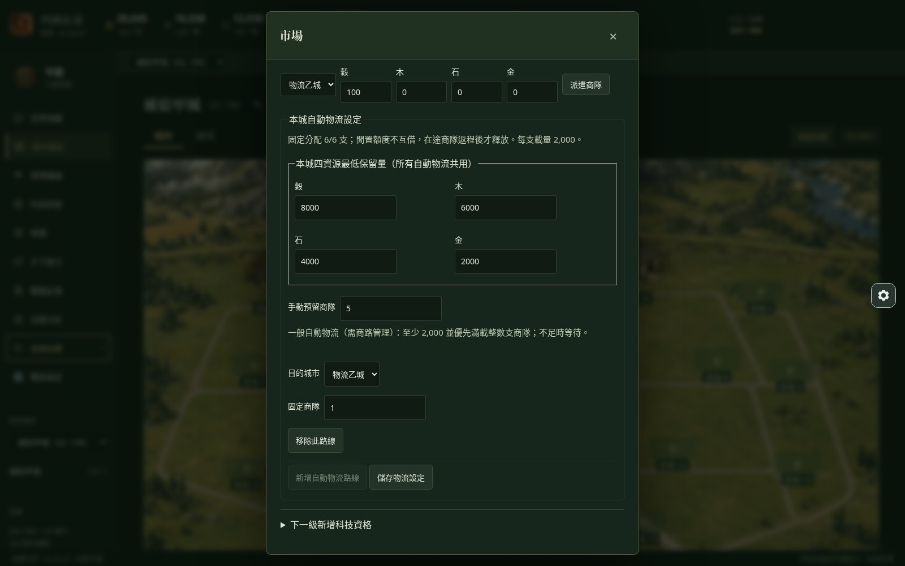
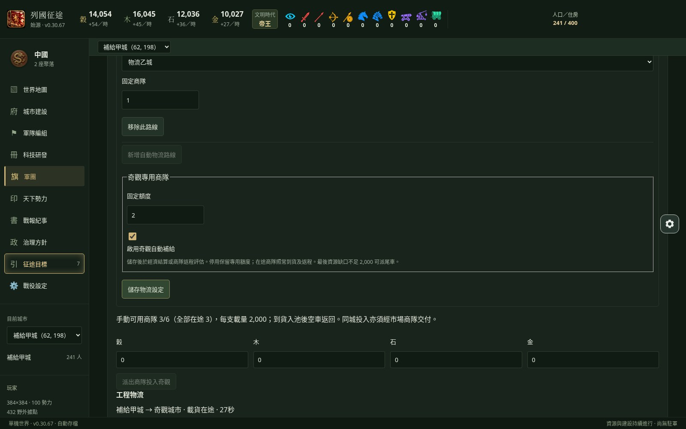
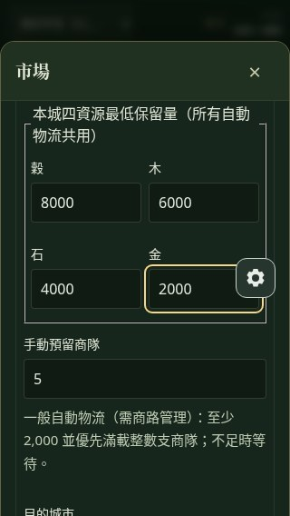
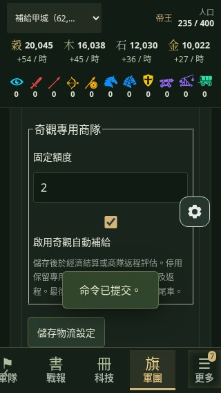

# 玩家自動物流 A／B 施工驗證

本輪從最新 main `f78477fc724b1c79816f7a932e0fd856f7a2ffdd` 建立 `feat/player-auto-logistics`，只使用一個 Draft PR。驗證日期：2026-10-27（Asia/Taipei）。歷史科技樹及科研驗證目錄未修改。

## 完成行為

- A：市場可設定多條自有城市路線與各路線固定商隊、手動預留，以及每城共用的四資源最低保留量。分配不得超過市場等級，上限 15。自動貨量以整支滿載 2,000 配送，不足則等待。
- B：帝國世界奇觀頁可選玩家來源城、配置奇觀專用額度並啟用／停用。使用正式 `wonder.ship` 路徑，派車扣實際庫存、到貨入池、返程釋放商隊；已到貨與在途都扣除需求。資源的最後缺口小於 2,000 才可派尾車。
- 一般路線、奇觀專用及手動額度不互借。出貨保存用途；調低額度、改路線、停用或市場降級不召回既有商隊，後續派車同時檢查用途與實體容量。設定分配超過降級後市場時，先停止新派車，待玩家重新分配。
- 排程沿用既有每城經濟結算及商隊返程事件；沒有新增輪詢事件或逐分鐘全世界掃描。玩家奇觀補給必須明確啟用，AI 奇觀策略檔案未修改。
- 新設定與用途為存檔可選欄位；未更改格式／版本常數、資料庫、CAS、Recovery 或 ACK 機制。舊路線取各資源最高保留量作為共用下限；舊商隊沒有用途標記時保守計入手動在途。無需重寫存檔。
- 奇觀需求仍為穀 4,000,000／木 7,000,000／石 9,000,000／金 4,000,000，合計 24,000,000；施工仍為 24 世界小時。成本、時間及 AI 決策程式沒有變更。

## 測試批次與來源

測試先依序完成 A、B，接著 Typecheck、Production Build 與受影響回歸，最後執行一次完整隔離回歸。每批結果獨立保存，不把不同批次相加宣稱一次全套 PASS。

| 批次 | 結果 | 證據 |
| --- | --- | --- |
| 受影響回歸（14 檔，包含 A 7／B 9／新 UI 2） | 205 通過、0 失敗、0 跳過 | [affected-tests.json](affected-tests.json) |
| 補上四資源、舊存檔與非法數值後的 A 定向 | 10 通過、0 失敗、0 跳過 | [general-final-tests.json](general-final-tests.json) |
| 新設定意圖衝突補修定向 | 22 通過、0 失敗；到貨測試加強後另 1 通過 | [conflict-fix-tests.json](conflict-fix-tests.json)、[admission-arrival-test.json](admission-arrival-test.json) |
| Typecheck | 通過 | 最終提交之 CI 另行完整重驗 |
| Production Build（網站根目錄） | 通過 | 原生瀏覽器使用此正式建置 |
| 最終完整隔離回歸 | 2050 通過、0 失敗、1 跳過，PASS；[統計](full-final.json) | 最終原始碼清單：[source-manifest.json](source-manifest.json)；中止批次：[full-run-source-manifest.json](full-run-source-manifest.json) |
| 修正後桌機／手機原生 Chromium | 3 通過、0 失敗、0 pageerror | [browser-final.json](browser-final.json)，1600×1000、320×568、390×844 |
| GitHub CI | 以本 PR 最新 HEAD 的 Checks／Actions 為準 | 完成後在本 PR Conversation 加入同 HEAD 的最終 CI 記錄及具體 Run URL，避免為更新 CI 文字再觸發完整 CI |

完整回歸使用 `node scripts/verify-in-isolation.mjs full`，沒有直接在工作目錄跑全套。先前定向測試產生的 `docs/ui-v03028` 輸出已還原，不覆寫歷史 UI 證據。Typecheck／Build 成功不表示 Gate 或實機驗收通過。

## 正式引擎證據

- [出貨／入池／返程帳本](engine-trip.json)：來源城穀 10,000，保留 4,000，奇觀配置 2 支；一次實扣 4,000 後剩 6,000。派車當下工程池為 0、在途需求已預約；到貨池增加 4,000，返程後才釋放額度。停用後不再補發。
- [奇觀最後 750 尾車](engine-tail.json)：先以正式手動商隊實際支付全部前置貨物，保留最後穀 750；自動尾車真實出貨，到貨後才進入施工，且只建立一個 24 世界小時完成事件。未注入工程池或縮減科技／奇觀成本來偽造完成。
- [99 AI 效能](99-ai.json)：完整 99 名 AI 原規則推進一個世界小時；有／無玩家奇觀自動補給的 AI 狀態、AI 指令收據完全一致。實測耗時為該檔案記錄值；它是合成環境觀察值，不是跨裝置效能保證。新增輪詢事件 0。
- 存讀檔涵蓋舊格式設定、四資源共用保留量、出貨在途、返程、最後缺口到齊；真正 Fake IndexedDB 持久層損壞 current 後走 Recovery，另驗證回復前設定命令的 rolled-back tombstone。線上一次／分段推進及正式離線 Cooperative 補算一致；不同提交批次的 `committedRevision` 依各自提交邊界比較，不要求分批回放使用相同 revision 數字。
- 其他邊界涵蓋固定配額總額衝突、重複目的城市、他國城市、不合法帝國、2,000 門檻、整車裝載、四項保留量、重複設定／重複事件評估、在途減額、移除路線後原額度仍被占用、停用、降級、非法負數／小數／NaN／Infinity。正式原有奇觀回歸另外覆蓋到貨授權及工程狀態。

## 原生瀏覽器與截圖

使用系統原生 Chromium、正式 Production Build、正式 Worker 及 IndexedDB。只匯入由正式產生器建立的合成世界；測試未直接修改瀏覽器存檔、工程池或商隊。最終測試世界使用原本正式 25X、鄰近合法城市及接近原有每小時結算點的時間錨定，以縮短等待；仍由正式排程扣款、出貨、到貨及返程。

首次腳本因城市預設停在「城郊」而未找到市場，已修正為先選「城內」。其後桌機及 320px 已通過，390px 在 Playwright 傳輸完整世界快照的解析耗時過長；腳本改成在頁內只讀必要來源城／奇觀／商隊再傳回。100X 批次仍未完整收斂，所以最終使用正式 25X，另分批保存 390px 及桌機／320px 結果；不把先前未完成的 100X 批次宣稱整套通過。完整回歸啟動後只調整瀏覽器腳本與合成測試輸出工具，這兩個驗證工具變更本身不要求重跑遊戲回歸。其後 25X 桌機驗證實際發現本輪新 `logistics.configure` 意圖戳範圍過廣，AI 的奇觀到貨會讓合法設定被當成過期；於是中止當時尚未完成的完整回歸，縮小新命令的語意前置條件並新增正式到貨競爭測試。ACK／CAS／持久層核心機制不變。最終修正後會完整驗證一次；未完成批次不計為 PASS。

修正前 25X 瀏覽器紀錄保留在 [browser-before-admission-fix.json](browser-before-admission-fix.json)：桌機 1 失敗（設定未提交）、320px 1 通過；另有 [390px 獨立通過批次](browser-390.json)。修正後已以同一程式與 25X 合成世界重新完整驗證三尺寸：3／3 通過、0 pageerror，見 [browser-final.json](browser-final.json)。修正前批次不當成最終全套結果。共保留 15 張最終截圖。

## 待清理、限制與剩餘風險

- 未核准的 `feat/wonder-player-auto-supply-20261027`：HEAD `5854931b4c168738d561e292843f678eb1887642`，列為待清理。僅查核分支身份，沒有讀取或沿用其實作、合併或刪除。
- 來源城共用保留量只約束自動物流；手動命令仍由玩家決定貨量，但受手動專用商隊上限約束。停用奇觀補給仍保留其固定額度，玩家可明確降低額度再調整其他用途。
- 舊存檔若原有多條路線額度總和已超過市場，讀取仍相容，但停止新派車，直到設定符合目前市場容量；在途貨物不召回、不丟失。
- 僅完成 Chromium 模擬手機尺寸；iOS Safari、Android 實機、鍵盤彈出與瀏海 safe-area 操作仍待玩家驗證。99 AI 測試不是長期超大型存檔壓力測試。
- 保留既有 AGENTS.md 歷史基準：legacy art 失敗紀錄、B5 E1 HOLD、Astra Gate 未 PASS、實機待驗；本輪測試通過不抹除歷史或宣告 Release Gate。
- 本 PR 保持 Draft；不合併 main、不部署、不關閉 Issue。完成即 STOP，等待 GPT-6 中控審查及玩家放行。

首次完整隔離批次：`/tmp/lieguo-verification-zvPAOw`，2026-10-27 01:57（Asia/Taipei）啟動，02:12 左右中止，未產生本輪最終統計。工作目錄 `artifacts/integration/regression-full.json` 當時仍是前輪舊檔（2026-10-26 12:08），不得拿舊檔當本輪結果。

最終原生帳本在三尺寸一致：來源城初始穀 20,000，正式結算到出貨時為 20,054；一般專用 1 支實扣 2,000，奇觀專用 2 支實扣 4,000，出貨後穀 14,054（木 16,045／石 12,036／金 10,027）。返程後奇觀池為穀 4,010／木 8／石 6／金 5，其中 4,000 為本城真實商隊，10／8／6／5 為既有 AI 正常投入；沒有把 AI 停用來取得通過結果。

最終完整隔離回歸於 `/tmp/lieguo-verification-frAOtR` 完成，凍結清單 22 檔全部雜湊一致；2050 通過／0 失敗／1 跳過。唯一跳過為既有私人存檔案例（沒有提供 `REALM_REGRESSION_SAVE`），未把它當成已驗。此批次是修正後唯一完成的完整本機回歸。
